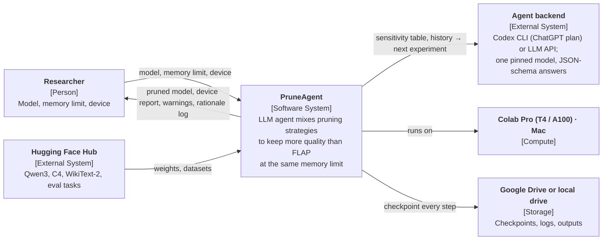
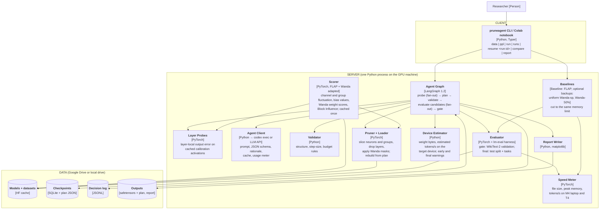
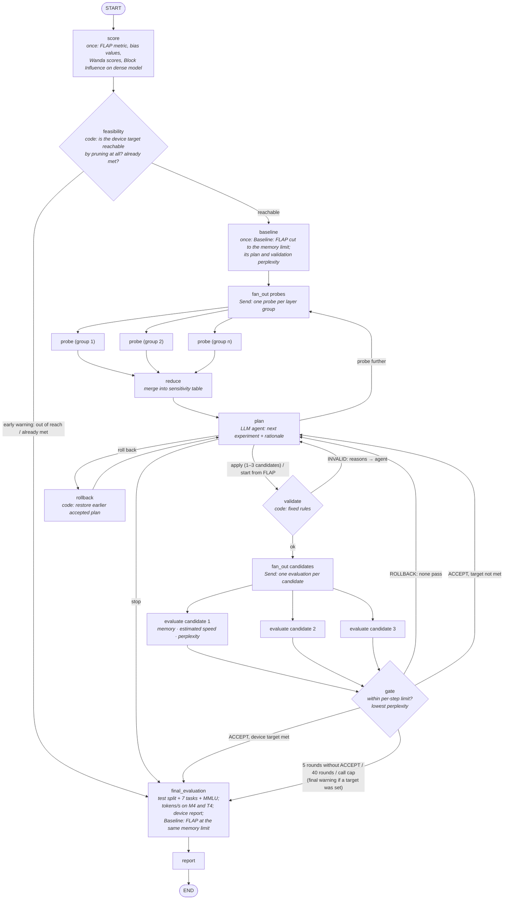
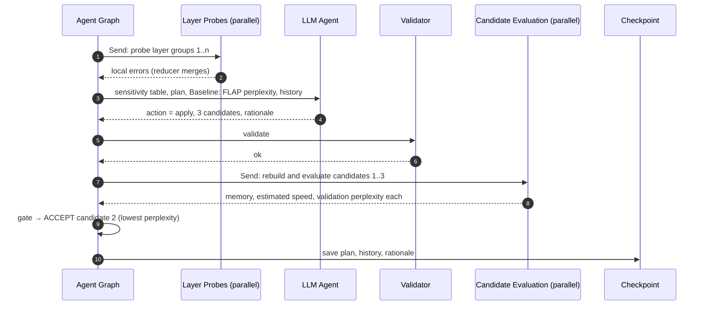

# PruneAgent v0.8: More Quality than FLAP at the Same Memory Limit

1.125 Agentic Engineering & Architecture, term project. Four build phases of 1–2 days each (about 9 days from 2026-11-16), one builder. Author: Steph Xu. Status: proposed, v0.8 (2026-11-17).

**Value statement.** PruneAgent produces a pruned model that fits a memory limit you set for your device while keeping more quality than FLAP, a standard method for shrinking a model without retraining, cut to the same limit; the result is actually smaller and faster, with a warning when pruning alone cannot reach the limit.

**Summary.** Wanda (unstructured pruning) keeps quality well at 50% sparsity, but its zeroed weights still occupy memory and compute, so the model is no smaller or faster. Structured pruning removes whole neurons, attention groups or layers, so the model really shrinks, but it costs more quality per parameter removed. PruneAgent solves one problem: given a memory limit (a required input), find the pruning that fits within it and keeps the most quality. The question it answers: does the agent keep more quality (perplexity and mean accuracy) than FLAP cut to the same memory limit (Baseline: FLAP)? FLAP is a structured method, and at moderate cuts it keeps the quality of Wanda at 50% sparsity, so one comparison answers the question. Results are reported against Baseline: FLAP with no allowance and no quality threshold. The unpruned model is the no-pruning reference point, not a baseline. The user can also give a minimum speed and the device's memory bandwidth and compute. If the memory limit is out of reach, the run warns before searching (beyond what pruning can remove at all), and reports the closest plan and the gap. An LLM agent chooses, per layer, from a neutral menu of strategies: narrow the MLP, remove attention groups, drop the layer, or apply unstructured Wanda. The agent decides only strategy: which strategy to apply to which layers. Code decides how much (one fixed step per choice), which neurons, groups or weights go (by their scores), and performs the pruning. Each round the agent proposes up to three candidate plans; code validates them and evaluates memory, estimated speed on the target device and perplexity (how well the model predicts real text; lower is better) for all candidates in parallel, then accepts the one with the best quality. Output: the pruned model, per-layer plan, a rationale for every decision, a device report (fits or not, estimated speed, warnings), and a comparison against Baseline: FLAP cut to the same memory limit (Wanda-50% and uniform Wanda-sp are optional backups, reported only if useful).

**Models (2026-11-16):** Qwen3-0.6B and Qwen3-1.7B mean the **Base** checkpoints throughout (`Qwen/Qwen3-0.6B-Base`, `Qwen/Qwen3-1.7B-Base`), as in Wanda, FLAP and most pruning work, so results compare directly with published numbers.

**Agent backend (2026-11-16):** the agent's decisions come from a swappable backend, chosen per run: Codex CLI (`codex exec` on the ChatGPT plan, read-only, no tools; no per-call charge, bounded by the plan's usage limits) or an LLM API (per-token cost, $5 per run cap). Both use the same prompt, JSON schema, validator, cache and log, with the model pinned (ADR-005).

**Calibration (2026-11-17):** every method learns which weights to remove from the same example text: 128 passages of 2,048 tokens from C4, a large collection of web pages (the set Wanda uses). This covers the agent's scores, Baseline: FLAP, and the backups (Wanda-50%, uniform Wanda-sp). Two reasons: every compared method sees the same data, and the example text comes from a different source than the WikiText-2 text used to measure quality, so no method is tuned on text like the test. FLAP's authors used WikiText-2 training text; that setting is kept only for the check of our FLAP code against theirs. FLAP numbers measured before 2026-11-17 (task 1.9's 15.2% of weight memory removed, and the 11.1% run with no allowance quoted in A7) used FLAP's own WikiText-2 calibration text, and are not directly comparable with later numbers; uniform Wanda-sp numbers from before that date used shorter C4 passages (128 tokens).

**Changes from v0.7 (2026-11-17):** the primary baseline is now FLAP cut to the same memory limit (Baseline: FLAP), replacing Baseline: Wanda-50%. Wanda-50% and uniform Wanda-sp become optional backups, reported only if useful; ShortGPT is dropped as a compared method (still cited, and its Block Influence score is still used). No allowance or quality threshold: results are reported against Baseline: FLAP. Reason: FLAP actually shrinks the model and, at moderate cuts, matches Wanda-50% quality (Qwen3-0.6B with 11.1% of weight memory removed: perplexity 16.63 vs. Wanda-50%'s 23.68; mean accuracy 43.95% vs. 43.80%).

**Changes from v0.6 (2026-11-17):** the problem is now: given a memory limit (required), keep the most quality. The no-target "save as much memory as the bar allows" mode is dropped; FLAP and uniform Wanda-sp are compared at the same memory limit on quality, not searched to the largest saving; Baseline: Wanda-50% is a reference with no allowance for now, and any allowance is decided after seeing results.

**Changes from v0.5:** optional device target as input (memory limit, minimum tokens/s, memory bandwidth, compute, CPU or GPU) with early and final warnings when it cannot be reached (ADR-006); speed estimated for the target device instead of the T4; speed measured on an M4 laptop and the Colab T4 (ADR-003); device-target demonstration runs added to phase 4.

**Changes from v0.4:** goal changed from "equal memory, effort saved" to "Wanda-level quality, maximum measured savings"; comparison now at equal quality (ADR-006); unstructured Wanda added to the agent's strategy menu, described neutrally (ADR-007); parallel evaluation of memory, latency proxy and perplexity for up to three candidate plans per round (ADR-001); fixed 20% / 30% targets removed; manual-sweep baseline and effort claim dropped; quantization deferred to a later optional step; ADRs moved into `adr/` (v0.3 copies in `adr/archive-v0.3/`).

**Files**

| File | Contents |
|---|---|
| `ARCHITECTURE.md` | This document |
| `WORKPLAN.md` | Phased work plan with gates, owners and budget by phase |
| `board/` | Local project board for the work plan (`python3 board/server.py`) |
| `adr/ADR-001…007` | Architecture decision records |
| `presentation/proposal.pdf` | PS06 proposal (6 slides + speaker-notes appendix + references); submitted copy at `ps06/stephxu96/proposal.pdf` |
| `presentation/PS06_Proposal.pptx` | Editable source of `proposal.pdf` |
| `presentation/PruneAgent_Proposal.pptx` | Earlier 9-slide draft (v0.1) |
| `presentation/build/` | Scripts that rebuild the decks (`build_ps06.py` for the PS06 deck) |

---

## 0. Background, Conventions and Conflicts

### 0.1 Prior Work

| Work | Approach | Gap |
|---|---|---|
| **Wanda** (Sun et al., ICLR 2024) | One-shot unstructured pruning; score = \|W\| × ‖X‖; no retraining | Zeroed weights keep matrix shapes: no memory or speed gain on standard hardware. Wanda-50% is an optional backup quality reference here |
| **FLAP** (An et al., AAAI 2024) | Retraining-free structured pruning: fluctuation metric per channel, adaptive global allocation, bias compensation; one forward pass. Introduces **Wanda-sp** (structured Wanda) as a baseline | Allocation by a fixed rule; LLaMA code; no feedback. Used here as the primary comparison (Baseline: FLAP) |
| **ShortGPT** (Men et al., 2024) | Removes whole layers ranked by Block Influence | Layer removal only; cited, not run (its Block Influence score is used for layer probes) |
| **LLM-Pruner** (Ma et al., NeurIPS 2023) | Structured pruning by dependency groups | Needs a LoRA recovery fine-tune; cited, not run |
| **OWL** (Yin et al., ICML 2024) | Non-uniform unstructured sparsity from outlier ratios | Unstructured; fixed heuristic |
| **AMC** (He et al., ECCV 2018) | RL agent (DDPG) sets per-layer pruning ratios for CNNs | Policy trained per model; vision only |
| **FastForward Pruning** (Yuan et al., 2025) | RL search of per-layer sparsity for LLMs | GPU-hours of search per model |
| **ProfilingAgent** (Jafari et al., 2025) | LLM agent picks compression settings from profiling data | Vision models only |
| **Kodathala & Vunnam** (Jan 2026) | LLM agent predicts per-layer unstructured Wanda sparsity for Qwen3-4B/8B; rolls back steps with perplexity rise > 15% | Unstructured only, so no memory or speed gain; no public code |

**Positioning.** Not a new pruning algorithm. An agent that mixes existing pruning strategies per layer to keep more quality than FLAP at the same memory limit, measured on real memory and speed.

### 0.2 Course Conventions Applied

| Convention (1.125) | Application |
|---|---|
| Name **who chooses the next step** | `ORCHESTRATION: hybrid.` The LLM agent chooses the next experiment and which strategy to apply to which layers; code owns step sizes, which weights are removed, pruning, validation, pruning, evaluation and accept / rollback. |
| **Evidence gates** with explicit states | Every round ends ACCEPT, ROLLBACK or INVALID by a fixed rule. |
| **Evidence must match the claim** | Quality from perplexity and multiple-choice accuracy (share of questions answered correctly); size from measured memory; speed estimated for the target device during search and measured in tokens per second on an M4 laptop and a T4 at the end. Never judged by an LLM. |
| **Fair test**, criteria fixed in advance | Baseline: FLAP and the memory limit fixed before the production run; every method cut to the same memory limit, one calibration set for every method (example text run through the model to decide which weights are removed: 128 passages of 2,048 tokens from C4, a different source from the WikiText-2 test text), same tests, same machines for speed. |
| **Validate before relying on it** | Phase 1 reproduces FLAP, Wanda and uniform Wanda-sp on Qwen3, checks layer-local probes against full evaluation, and checks the device speed estimate against measured speed on the M4 and T4. |
| **Smallest system that meets the needs** | One model family; quantization deferred; LangGraph used for parallel probes, parallel candidate evaluation and the experiment-choice branches (ADR-001). |

### 0.3 Conflicts and Resolutions

| # | Conflict | Resolution |
|---|---|---|
| C1 | "The key question is whether the agent makes better decisions than an existing algorithm" (instructor) | At the same memory limit, the agent must keep more quality than Baseline: FLAP (S2); a negative result is reported as a valid outcome (S4). |
| C2 | A single loop does not need a graph framework | The workflow fans out parallel probes and parallel candidate evaluations, and branches on the agent's choice of experiment (ADR-001). |
| C3 | Unstructured sparsity saves no memory or time on a T4 or Mac | That is why the primary comparison is FLAP, which removes whole neurons and groups; Wanda-50% is at most a backup quality reference. Savings come from structured strategies, and memory is measured with zeros counted at full cost (ADR-006, ADR-007). |
| C4 | The LLM-agent pruning idea is published (Jan 2026) | Different claim: more quality than FLAP at the same memory limit, with real savings, from a mixed structured and unstructured menu, with open code; cited directly. |
| C5 | "Cut scope" (instructor) | Quantization deferred; manual-sweep baseline and effort claim dropped; one primary baseline (FLAP) and no ShortGPT comparison (v0.8). |
| C6 | A strategy that saves nothing (unstructured Wanda) in the agent's menu | Kept and described neutrally: removing it would make the choice for the agent. How often each strategy is chosen is reported (P1). |
| C8 | An LLM is unreliable at choosing numbers (a Codex test proposed a 20% cut where the rules allow 10%) | The agent chooses strategies only; code sets every amount and does all pruning (§4.2) |
| C7 | Which device to optimize for: a T4 is not where small models are deployed | Device target is a user input; the objective (most quality within the memory limit) is the same on every device (ADR-006). |

---

## 1. Requirements and Scope

### 1.1 Inputs, Constraints and Outputs

| | |
|---|---|
| **Input** | Qwen3 model; memory limit (see device target) |
| **Device target** | Memory limit (GB, required); optional minimum decode speed (tokens/s), the device's memory bandwidth (GB/s), compute (TFLOPs) and CPU or GPU |
| **Constraints** | ≤ 15% perplexity rise per accepted step; ≤ 60 agent calls per run; with the API backend, also ≤ $5 per run |
| **Output** | Pruned model, per-layer plan, decision rationale log, device report (fits or not, estimated speed, warnings), comparison vs. Baseline: FLAP cut to the same memory limit and vs. the unpruned model (no-pruning reference), with measured quality, memory and tokens per second; Wanda-50% and uniform Wanda-sp only if useful |
| **Target out of reach** | Early warning before the search if the target is beyond what pruning can remove at all, or already met by the unpruned model. Final warning if the result fits but keeps less quality than Baseline: FLAP: reports the gap in perplexity and accuracy, and any speed shortfall |

### 1.2 Functional Requirements

| ID | Requirement | Verified by |
|---|---|---|
| FR1 | Accept model, memory limit, optional speed target, agent backend (Codex or API) and call cap; compute Baseline: FLAP by cutting FLAP to the memory limit | CLI test; FLAP matches its adapted reference code; FLAP's model fits the limit |
| FR2 | Run layer-local sensitivity probes (MLP width, attention groups, layer drop, Wanda sparsity) in parallel; merge into one sensitivity table | Probe test on Qwen3-0.6B |
| FR3 | Agent selects the next experiment (probe, apply 1–3 candidates, start from FLAP, roll back or stop) and, for apply and probe, which strategy for which layers; its output contains no amounts | Agent-graph test with a fake LLM |
| FR4 | Validator enforces structure, step-size and budget rules | Validator unit tests |
| FR5 | Prune to the plan: FLAP scoring and bias compensation for structured cuts (adapted to Qwen3 grouped-query attention), Wanda scoring for unstructured sparsity | Matches adapted FLAP and Wanda references |
| FR6 | Evaluate each candidate in parallel: weight memory, estimated speed on the target device, validation perplexity on a fixed 32-window subset, skipping the unchanged layers before the candidate's first change (their saved output is reused; every later layer is recomputed) | Parallel-evaluation test; skipping unchanged early layers gives the same perplexity as running every layer |
| FR7 | Gate: among candidates within the per-step quality limit, accept the one with the lowest perplexity; otherwise roll back | Rollback test |
| FR8 | Stop when the memory limit is met, on a stop action, 5 rounds without an accepted step, 40 rounds or call cap | Graph tests |
| FR9 | Log every decision with its rationale, strategies chosen, evaluation count and GPU time | Log schema test |
| FR10 | Final evaluation of the agent, Baseline: FLAP cut to the same memory limit and the unpruned model (optionally Wanda-50% and uniform Wanda-sp), with measured memory and tokens per second on the M4 laptop and the T4 | End-to-end run |
| FR11 | Checkpoint each step to Google Drive or local drive under the run's id; `pruneagent resume <run-id>` (or no id when exactly one run is paused) continues after a disconnect | Kill-and-resume test; two paused runs: resume without an id refuses and lists them |
| FR12 | Save the pruned model as safetensors + plan JSON; loader rebuilds it with per-layer widths | Round-trip test: same perplexity after reload |
| FR15 | Agent usage limits: before a run, estimate whether its calls fit the remaining Codex limits and warn if not; after every call, read the limit status; on a limit (or API cap) reached, checkpoint and pause with the reset time; `resume` continues from the last checkpoint after the reset or on the other backend | Tests with recorded limit readings: fits, warns, pauses, resumes without repeating a call |
| FR13 | Early warning before the search: target below the smallest model the structure rules allow, or already met by the unpruned model | Unit tests with an impossible, an already-met and a reachable target |
| FR14 | Final warning when the memory limit cannot be reached or the result keeps less quality than Baseline: FLAP: closest plan, GB over the limit, quality gap, tokens/s short of any speed target | Device-target runs in phase 4 (one reachable, one not) |

### 1.3 Success Criteria

| # | Criterion |
|---|---|
| S1 | Quality reported against Baseline: FLAP at the same memory limit on held-out data (WikiText-2 test perplexity and average multiple-choice accuracy), with no allowance or quality threshold; the unpruned model is shown as the no-pruning reference point |
| S2 | At the same memory limit, better quality (perplexity and mean accuracy) than Baseline: FLAP cut to that limit; faster than the unpruned model in measured decode tokens per second on the M4 laptop and the T4 |
| S3 | ≤ 2 h per run; within the ChatGPT plan's usage limits (Codex backend) or ≤ $5 (API backend); resumes after interruption |
| S4 | A well-supported negative result is a valid outcome |

**Prediction (reported, not a pass/fail criterion).** P1: because unstructured Wanda saves no memory, an agent that understands the objective will rarely choose it. Measured by how often each strategy is chosen and accepted.

### 1.4 Scope

| In scope | Out of scope |
|---|---|
| Qwen3-0.6B (development), Qwen3-1.7B (production run) | Other model families; models > 2B |
| Per layer: MLP neurons, attention groups, whole layers, unstructured Wanda sparsity | Hidden-dimension pruning across all layers (SliceGPT-style); embedding pruning; 2:4 sparsity |
| Device target (memory limit required) with early and final warnings; speed estimated for the target device | Running on a phone (phone targets are estimates only) |
| Speed measured on an M4 laptop and the Colab T4 | Speed measured on the A100 |
| Post-training only | Retraining or fine-tuning |
| | Weight quantization (optional one-time step after the search, §9) |
| | Sweeping device targets to map where the tool is effective (later, §9) |

### 1.5 Roles

| Who | Does |
|---|---|
| **Steph** | Writes the agent instructions; tunes them on Qwen3-0.6B only; makes design decisions (§13) |
| **Coding agent** | Implements probes, validator, FLAP and Wanda adaptation, loader, evaluator, memory and latency meters, agent graph, report, tests |
| **System** | Computes Baseline: FLAP at the memory limit, probes, plans, prunes, evaluates, accepts or rolls back, runs any backup baselines, writes the report, logs every decision |

No hand labelling and no hand-made data: all models and datasets are public.

### 1.6 Assumptions

| # | Assumption | If wrong |
|---|---|---|
| A1 | Layer-local probe error ranks layers like whole-model perplexity does | Probes guide exploration only; every accepted step is gated on full-model perplexity; checked in phase 1 |
| A2 | Qwen3 runs in fp16 on a T4 without overflow | fp32 fallback on T4; production run on A100 (bf16) |
| A3 | 270 Colab Pro compute units cover the project within a 200-unit cap | T4 only; Qwen3-0.6B only |
| A4 | FLAP, Wanda-sp and Wanda code adapts to Qwen3 in a few hours | Reimplement the fluctuation metric and bias compensation directly (~150 lines) |
| A5 | Scores computed once on the dense model stay good enough as the plan changes (ADR-002) | Recompute scores after each accepted step |
| A6 | Estimated decode speed (memory bandwidth ÷ bytes read per token) ranks plans like measured tokens per second on the M4 and the T4 | Measure tokens per second on the accepted plan every 5 rounds; report measured speed only |
| A9 | A fixed 32-window subset of the validation split ranks candidate plans like the full 128 windows | Gate on 64 windows, or on the full split with candidates spread across Mac and Colab |
| A8 | Estimates for a device that cannot be measured (a phone) are useful if the estimate is within ~25% of measured speed on both the M4 and the T4 | Report phone results as memory fit only, without a speed estimate |
| A7 | FLAP is a strong enough comparison: at moderate cuts it keeps Wanda-50%'s quality while actually shrinking the model (checked on Qwen3-0.6B: 11.1% of weight memory removed, perplexity 16.63 vs. 23.68, mean accuracy 43.95% vs. 43.80%; measured before 2026-11-17 with FLAP's WikiText-2 calibration, so not directly comparable with later numbers) | Report Wanda-50% alongside as a backup quality reference |

---

## 2. System Context (C4 Level 1)



---

## 3. Containers (C4 Level 2)

`ORCHESTRATION: hybrid. The LangGraph agent graph and fixed rules (code) own probing, step sizes, the choice of weights to remove, validation, pruning, evaluation and accept / rollback. The LLM agent chooses the next experiment and which strategy to apply to which layers; it never sets amounts.`



### 3.1 Development Tools

| Tool | Use |
|---|---|
| Git + GitHub | Code, agent instructions, ADRs; commit id in every log |
| uv + lock file | Pinned PyTorch, Transformers, LangGraph, lm-eval |
| PyTorch + Hugging Face Transformers | Model loading and inference |
| FLAP and Wanda reference code (adapted to Qwen3) | Baseline: FLAP, scoring, bias compensation, backup Wanda-50% and Wanda-sp comparisons |
| lm-evaluation-harness | Multiple-choice question sets and MMLU |
| Colab Pro (T4 / A100) | T4 for development and speed measurement; A100 for the production run; 200 of 270 compute units |
| Google Drive or local drive | Checkpoints, logs, outputs |
| Mac (M4) | Development on Qwen3-0.6B (PyTorch fp16); speed measurement on the Mac GPU |
| pytest + GitHub Actions | Validator, loader, graph and report tests |
| Codex CLI (`codex exec`) | Agent decisions: read-only sandbox, empty working directory, no saved sessions, JSON-schema output, pinned model and reasoning effort |
| LLM API (optional backend) | Same prompt and JSON schema through the provider's structured-output mode; key from `.env` or Colab Secrets |
| LLM cache + usage ledger | No repeated calls; calls, tokens, seconds and (API backend) dollars per run |

---

## 4. Agent Graph (LangGraph)

### 4.1 Graph



**Parallelism.** Two fan-outs. Probes are layer-local: each changes one layer (or layer group) and measures that layer's output error on cached calibration activations, so many run at once on one GPU. Candidate evaluation runs up to three candidate plans at once; for each, memory and estimated speed on the target device are computed from the plan without the GPU, and validation perplexity runs on the GPU. Rebuilding a model from a plan is a fast slicing and masking step (ADR-002).

**Skip unchanged early layers.** A candidate usually changes only a few layers, say from layer 20 on. Layers 0–19 are identical to the last accepted model and get the same input text, so their output is identical too: it is saved once (from the accepted model) and loaded instead of recomputed. Every layer from the first changed layer onward is always recomputed, because its input changes. If a candidate changes layer 0, nothing is skipped. The saved outputs take about 134 MB per layer for 32 windows on Qwen3-0.6B (~3.8 GB in total); after a plan is accepted they are refreshed from its first changed layer onward, and after a rollback they are rebuilt. On the M4, checking one candidate takes ~15–63 s depending on where its first change is (~40 s on average), against 265 s for a full validation pass. Running several candidates on one machine does not help: the M4 GPU is already fully busy with one window at a time, so parallel candidates go to separate machines (Mac and Colab).

**Grouped-query attention.** Qwen3-0.6B and 1.7B have 16 query heads and 8 key/value heads per layer. Attention is pruned one key/value group at a time: removing a group removes its key and value heads and the 2 query heads that share them, with the matching columns of the output projection.

### 4.2 Agent Action Space

| Action | Effect |
|---|---|
| `probe` | Choose layers and strategies to probe; code tests each at 1, 2 and 3 steps ahead of the current plan |
| `apply` | Propose 1–3 candidates, each a set of (layer, strategy) choices; code applies one step of each |
| `start_from_flap` | Use Baseline: FLAP's allocation, cut to the memory limit (computed by code), as a candidate |
| `rollback` | Restore an earlier accepted plan |
| `stop` | End search; go to final evaluation (code also stops the search when the device target is met) |

**Per-layer strategies** (available in every `probe` and `apply`). The agent names the strategy; code sets the step and picks what is removed:

| Strategy | One step (set by code) | What is removed (chosen by code) |
|---|---|---|
| `narrow_mlp` | 10% of the layer's original MLP width, rounded to 64 neurons | Lowest-scoring neurons (FLAP metric), with bias compensation |
| `remove_attention_group` | One key/value group and its 2 query heads | Lowest-scoring group (FLAP metric) |
| `drop_layer` | The whole layer | That layer |
| `wanda_sparsity` | +10 points of unstructured sparsity on the layer's remaining weights | Lowest-scoring weights (Wanda score) |

**Division of work.** The agent's judgment goes where it adds value: which strategy suits which layer, given the sensitivity table and history. Everything numeric or mechanical is code: step sizes, which weights go, the pruning itself, limits, evaluation and accept / rollback. A candidate that applies the same strategy to the same layer twice takes two steps.

The agent's instructions describe each strategy by what it does to the weights, at the same level of detail, and state the objective (fit within the memory limit while keeping the most quality). They do not rank strategies. Every action carries a rationale, logged with the result.

### 4.3 State

```python
class LayerPlan(TypedDict):
    mlp_keep: int          # MLP neurons kept, multiple of 64
    groups_keep: int       # key/value groups kept, 1–8 (2 query heads each)
    dropped: bool          # whole layer removed
    wanda_sparsity: float  # unstructured sparsity on remaining weights, 0.0–0.7

class PruneState(TypedDict, total=False):
    run: RunConfig                              # model, device target, limits, call cap, seed
    baseline: Baseline                          # Baseline: FLAP cut to the memory limit: plan and perplexity
    sensitivity: Annotated[dict[str, LayerProbe], merge_probes]   # reducer for parallel probes
    plan: dict[int, LayerPlan]                  # the ONLY thing pruning depends on
    accepted: list[AcceptedPlan]                # history of accepted plans (rollback targets)
    candidates: Annotated[list[CandidateResult], operator.add]    # reducer for parallel evaluation
    action: AgentAction | None
    check: CheckResult | None
    gate: GateResult | None
    history: Annotated[list[StepRecord], operator.add]
    warnings: Annotated[list[DeviceWarning], operator.add]   # early and final
    usage: Annotated[Usage, add_usage]
```

### 4.4 Fixed Rules

| Rule | Default |
|---|---|
| Per layer per step | One step per chosen (layer, strategy), sizes as in §4.2; at most 2 steps of the same strategy on one layer per candidate |
| Layers dropped per step / per run | ≤ 1 / ≤ 6 |
| Minimum per remaining layer | ≥ 25% of MLP width; ≥ 1 key/value group; Wanda sparsity ≤ 70% |
| Per-step limit | Reject a candidate if validation perplexity rises > 15% over the last accepted plan |
| Accept | Among candidates that pass: the one with the lowest perplexity, ties broken by estimated speed |
| Candidates per round | ≤ 3 |
| Stop | Device target met; 5 rounds in a row without ACCEPT; 40 rounds; 60 agent calls; $5 with the API backend |
| Early warning | Target memory below the smallest model the rules above allow (every layer at its minimum, 6 layers dropped, embeddings unchanged), or target already met by the unpruned model |
| Max invalid proposals in a row | 3, then stop with the last accepted plan |

### 4.5 Agent Input and Output

Input: the objective; the device target, if any; the strategy menu (§4.2); sensitivity table (one row per layer: probe error per strategy at 1, 2 and 3 steps, Block Influence, current plan); current weight memory and estimated speed vs. dense and vs. the target; current and last accepted perplexity, and Baseline: FLAP's perplexity at the memory limit (on the same 32 windows); last steps with decisions and reasons. Output (JSON):

```json
{"action": "apply",
 "rationale": "Layers 20–24 lose little when narrowed; layer 25 has the lowest Block Influence and a small drop error.",
 "candidates": [
   [{"layer": 21, "strategy": "narrow_mlp"}, {"layer": 25, "strategy": "drop_layer"}],
   [{"layer": 21, "strategy": "narrow_mlp"}, {"layer": 22, "strategy": "remove_attention_group"}],
   [{"layer": 21, "strategy": "narrow_mlp"}, {"layer": 23, "strategy": "wanda_sparsity"}]
 ]}
```

Code turns each choice into a plan change (e.g., `narrow_mlp` on layer 21: 3,072 → 2,752 neurons on Qwen3-0.6B), checks the limits, prunes and evaluates.

---

## 5. Components and Interfaces

| Component | Responsibility | Interface |
|---|---|---|
| Baseline | Cut FLAP to the memory limit (the smallest FLAP ratio whose weights fit); record its plan and validation perplexity before the search, test perplexity and multiple-choice accuracy at the end | `flap_at_memory_limit(model, stats, memory_limit) -> Baseline` |
| Scorer | FLAP fluctuation scores per MLP neuron and attention group; bias compensation values; Wanda weight scores; Block Influence per layer; computed once on the dense model, all from the one calibration set (C4, 128 × 2,048 tokens) | `score(model, calib) -> Scores` |
| Layer Probes | Layer-local output error for each chosen strategy at 1, 2 and 3 steps (settings set by code) | `probe(layer, strategies, cached_acts, scores) -> LayerProbe` |
| Agent Client | Prompt, JSON schema, parse, cache, usage meter; calls one backend: `CodexBackend` (`codex exec`, read-only; sessions saved so usage-limit readings can be read, FR15) or `ApiBackend` (provider SDK, structured output, cost meter) | `decide(state) -> AgentAction`; `Backend.complete(prompt, schema) -> (json, usage)` |
| Validator | Fixed rules | `check(action, plan, run) -> CheckResult` |
| Pruner | Keep top-scoring neurons and groups, add compensation bias, drop layers, apply Wanda masks; from dense weights | `prune(dense_ref, plan, scores) -> Model` |
| Loader | Save safetensors + plan JSON; rebuild Qwen3 with per-layer widths | `save(model, plan, path)`; `load(path) -> Model` |
| Evaluator | Gate (validation split) and final evaluation (test split, tasks) | `gate_ppl(model) -> float`; `final(model) -> FinalScores` |
| Device Estimator | Weight bytes, bytes read per generated token and prompt FLOPs from the plan; estimated tokens/s on the target device; early and final warnings | `estimate(plan, device) -> Estimate`; `feasibility(model, rules, device) -> DeviceWarning \| None` |
| Speed Meter | File size, peak memory, prefill and decode tokens/s on the M4 laptop (Mac GPU) and the T4 | `measure(model, machine) -> MemoryReport` |
| Comparisons | Baseline: FLAP cut to the agent's memory limit; unpruned model (no-pruning reference); optional backups: uniform Wanda-sp cut to the same limit, Wanda-50% (saves no memory) | `make(name, model, memory_limit) -> dict[int, LayerPlan]` |
| Report Writer | Quality, memory, speed, strategy counts, rationale log, charts | `write(state, scores, baseline_scores, out_dir) -> Report` |
| Agent Graph | LangGraph graph | `build_graph(deps) -> CompiledGraph`; `run(cfg, resume=False)` |

---

## 6. Data and Evaluation

| Role | Dataset | Link |
|---|---|---|
| Calibration: the one set every method uses (the agent's scores and probes, Baseline: FLAP, Wanda-50%, uniform Wanda-sp); a different source from the evaluation text | C4 `en`, 128 samples × 2,048 tokens (FLAP's own WikiText-2 training set is kept only to check our FLAP code against the authors'; FLAP numbers measured before 2026-11-17 (task 1.9's 15.2% of weight memory removed, and the 11.1% run with no allowance quoted in A7) used FLAP's own WikiText-2 calibration text, and are not directly comparable with later numbers) | https://huggingface.co/datasets/allenai/c4 |
| Gate (every candidate) | WikiText-2 validation split, a fixed subset of 32 of its 128 windows, every 4th window starting at the first; Baseline: FLAP's perplexity on these same 32 windows is shown to the agent. The full split is used for reported results | https://huggingface.co/datasets/Salesforce/wikitext (`wikitext-2-raw-v1`) |
| Final perplexity | WikiText-2 test split | same |
| Final multiple-choice accuracy (Wanda's 7 question sets; no practice examples given) | BoolQ, RTE, HellaSwag, WinoGrande, ARC-Easy, ARC-Challenge, OpenBookQA via lm-evaluation-harness | https://github.com/EleutherAI/lm-evaluation-harness |
| Knowledge | MMLU | https://huggingface.co/datasets/cais/mmlu |
| Models | Qwen3-0.6B-Base (development), Qwen3-1.7B-Base (production run), Apache 2.0 | Hugging Face Hub |

**Methods compared (ADR-004, ADR-006):** Baseline: FLAP, cut to the same memory limit as the agent (the S2 comparison); the unpruned model as the no-pruning reference point (not a baseline). Optional backups, reported only if useful: uniform Wanda-sp cut to the same memory limit (a weaker structured method), and Wanda at 50% unstructured sparsity (saves no memory, so at most a quality reference). ShortGPT and LLM-Pruner are cited, not run.

**Memory and speed.** During search: weight memory in dense fp16 storage, zeros counted at full cost, embeddings included; estimated decode speed on the target device = memory bandwidth ÷ bytes of weights and key/value cache read per generated token at a 512-token context; estimated prompt time = FLOPs for a 512-token prompt ÷ device compute. The memory limit counts weights only (the model file size; decided 2026-11-17); the key/value cache is reported separately in the device report at a 2,048-token text length. For ranking plans and checking a minimum speed, a fixed cost per kept layer is added to each token's estimated time, fitted on the task 1.7 measurements: 0.23 ms per layer on the M4 and 1.40 ms on the T4 (with their measured bandwidths; 0.32 ms and 1.45 ms with the datasheet values), which brings the estimate within 2% (M4) and 10% (T4) of measured decode speed (`estimate.LAYER_COST_S`, results/speed_check/layer_cost.json). Speed is reported, and a minimum speed accepted, only for the M4 and the T4; other devices get memory fit only. At the end, on the M4 laptop and the Colab T4 for every method: parameter count, file size, peak memory, prefill and decode tokens per second at a fixed prompt length, batch size and generation length (ADR-006).

**Example device targets** (values confirmed in phase 1; phone values are placeholders):

| Target | Memory limit | Bandwidth | Measured? |
|---|---|---|---|
| M4 laptop (GPU) | 16 GB system memory | ~120 GB/s | Yes |
| Colab T4 | 15 GB | ~320 GB/s | Yes |
| Phone (example) | ~2–3 GB for one app | ~50–60 GB/s | No: estimate only |

**Separation.** The gate, and the perplexity of Baseline: FLAP shown to the agent, use the validation split; reported results use the test split; instructions are tuned on Qwen3-0.6B only and frozen before the Qwen3-1.7B production run.

**Search measures.** Full-model evaluations, probe count, GPU time, agent calls and tokens, and how often each strategy is proposed and accepted, from the decision log.

**System tests.** Perplexity with unchanged early layers skipped equals a full run through every layer; validator rules; rollback restores the exact earlier perplexity; save-and-reload gives the same perplexity; pruner matches adapted FLAP and Wanda references; probe ranking vs. full evaluation; speed-estimate ranking vs. measured tokens/s on M4 and T4; early-warning cases; kill-and-resume; graph with a fake LLM.

---

## 7. Data Schemas

| Type | Fields |
|---|---|
| `RunConfig` | model_id, baseline_method (flap), device: DeviceTarget (memory limit required), calibration: Calibration, rules: Rules, gate_windows (32), layer_cost_s (per-layer cost added to the speed estimate when ranking plans and checking a minimum speed; by default the value fitted for the M4 or the T4, 0 elsewhere), agent_backend (codex / api), agent_provider, agent_model, agent_reasoning_effort, max_agent_calls, max_cost_usd (API only; $5 by default), seed, dtype, gpu |
| `Calibration` | dataset (c4), n_samples (128), seqlen (2,048), seed: the one set every method uses |
| `Rules` | the §4.4 numbers: max_same_steps, max_drops_per_candidate, max_drops_per_run, min_mlp_fraction, min_groups, max_wanda_sparsity, max_candidates, step_limit, max_rounds, max_rounds_without_accept, max_invalid_in_row |
| `DeviceTarget` | name, memory_limit_gb, min_decode_tok_s (optional), bandwidth_gb_s, compute_tflops, backend (cpu / gpu) |
| `DeviceWarning` | kind (out_of_reach / already_met / below_flap), closest_plan, memory_gap_gb, speed_gap_tok_s, message |
| `Baseline` | method (flap), calibration, memory_limit_gb, ratio, plan, weight_bytes, val_ppl, val_ppl_subset (the gate's 32 windows), test_ppl, multiple_choice_mean |
| `Scores` | channel_fluct per layer, group_fluct per layer, bias_baseline per layer, wanda_scores per layer, block_influence per layer |
| `LayerProbe` | layer, candidates (strategy, setting), local_error per candidate, block_influence |
| `SensitivityTable` | dense_ppl, measured_windows, rows: {layer: layer, block_influence, quick_tests (strategy, steps, local_error), measured_ppl per strategy (whole-model perplexity with one step on that layer alone, measured once before the search)} |
| `LayerPlan` | mlp_keep, groups_keep, dropped, wanda_sparsity |
| `AgentReply` (was `AgentAction`) | action, rationale, candidates: list of {choices: list of {layer, strategy (narrow_mlp / remove_attention_group / drop_layer / wanda_sparsity)}, rationale} (a bare list of choices is also read); probe: list of {layer, strategy}; rollback_to (accepted-plan index, optional); no amounts |
| `AgentRequest` | what the agent sees (§4.5): objective, device, strategy_menu, rules, sensitivity, plan, dense / current / limit weight bytes, estimated speed now and unpruned, current, last accepted and Baseline: FLAP perplexity, recent steps, round |
| `CheckResult` | ok, reasons (written for the agent), candidates: per candidate {index, ok, reasons, plan, weight_bytes} |
| `Estimate` | weight_bytes, decode_bytes_per_token, prefill_flops, est_decode_tok_s, est_prefill_s, meets_target |
| `CandidateResult` | candidate_id, choices, rationale, plan, estimate, rank_decode_tok_s (estimate with the per-layer cost), val_ppl, step_rise |
| `GateResult` | chosen_candidate, decision (ACCEPT / ROLLBACK) |
| `StepRecord` | round, action, rationale, reply, check, candidates, gate, outcome (ACCEPT / ROLLBACK / INVALID), strategies_used, llm_tokens, llm_seconds, llm_cost_usd (API), gpu_seconds |
| `MemoryReport` | params, file_size_mb, peak_memory_mb, prefill_tok_s, decode_tok_s, machine (m4 / t4) |
| `FinalScores` | ppl_test, tasks: {name: accuracy}, mmlu, memory: list[MemoryReport] |
| `DeviceReport` | target, fits_memory (weights only), memory_gap_gb, weight_bytes, kv_cache_bytes at kv_context (2,048 tokens; not part of the limit), closest_plan (when the limit is not met), speed_reported, est_decode_tok_s (with the per-layer cost), speed_gap_tok_s; speed only for the M4 and the T4, memory fit only for other devices such as a phone (G1, A8) |
| `Report` | run, baseline, final plan, methods (name, plan, weight bytes, final scores: the agent, Baseline: FLAP, the unpruned model, any backup), device report and warnings, strategy counts (proposed, accepted), rationale log, usage; rejected if Baseline: FLAP used another calibration set or memory limit |

Types are in `src/pruneagent/schema.py` (pydantic; unknown fields rejected; JSON round-trip). Changes from v0.8's table, made in task 2.1: the §4.4 numbers move into `Rules` (so `step_limit` and `max_candidates` sit there, not at the top of `RunConfig`), so the validator and the gate read one copy; `Calibration` records the one calibration set, and the report rejects a baseline with another; the sensitivity table carries the measured per-layer damage beside the quick tests, the speed ranking a per-layer cost, and the device report memory fit only for unmeasured devices (the G1 decisions); `AgentAction` is renamed `AgentReply`, and each candidate carries its own rationale, as the round-1 replies did; `CheckResult` gives a verdict per candidate.

---

## 8. Sequence: One Round



---

## 9. Project Plan

| Phase (days) | Build | Done when |
|---|---|---|
| **1: Feasibility (D1–D2)** | Wanda at 50% on Qwen3-0.6B and 1.7B (the reference until v0.7, now a backup); FLAP and Wanda-sp adapted to Qwen3 (grouped-query attention); loader from plan JSON; device estimator; speed meter on M4 and T4; FLAP and uniform Wanda-sp compared with Wanda-50% on 0.6B; probes and speed estimate checked against full evaluation and measured speed on both machines; one agent round end to end | References reproduce; save-and-reload exact; FLAP's quality against Wanda-50% known (A7); probe and estimate rankings validated (A1, A6, A8) |
| **2: Agent Graph (D3–D4)** | Parallel probes; planner and action space; validator; parallel candidate evaluation; gate; device target with early and final warnings; rollback; checkpoints; fake-LLM tests | Midpoint: end-to-end run on Qwen3-0.6B with at least one ACCEPT and one ROLLBACK |
| **3: Tuning (D5–D6)** | Tune agent instructions on 0.6B against Baseline: FLAP at the same memory limit; kill-and-resume; report writer | Instructions frozen |
| **4: Evaluation (D7–D8, buffer D9)** | Baseline: FLAP cut to the production run's memory limit on Qwen3-1.7B (uniform Wanda-sp optional); production run on Qwen3-1.7B (A100) at that memory limit; one run at a limit pruning cannot reach; final evaluation vs. Baseline: FLAP and the unpruned model; memory and tokens/s on M4 and T4; report; demo; 1 day buffer | Report with quality, memory, speed, device reports and strategy counts; README reproduces it |

**Descoping order:** backup baselines (uniform Wanda-sp, Wanda-50%) → device-target runs on 0.6B instead of 1.7B → one candidate per round instead of three → MMLU → Qwen3-0.6B only.

**Later (optional, not in this build): weight quantization.** A one-time step after the search ends: quantize the final model's weights to 8-bit or 4-bit (weights only; activations and the key/value cache stay in fp16), then repeat the same memory, speed and perplexity checks. Baseline: FLAP is quantized the same way so the comparison stays at the same memory; Wanda-50% is not quantized.

**Later (bonus, not in this build): sweep of device targets.** Run the tool across a range of memory and speed targets to map how much quality pruning alone keeps at each target and where it warns: a sensitivity analysis of the tool itself.

---

## 10. Budget

| Item | Plan |
|---|---|
| Agent calls, Codex backend | No per-call charge. ~40–60 calls per run at ~5 s and ~3.1k input tokens plus the prompt each after trimming (measured 2026-11-17; ~19.4k before). Measured on the Plus plan: 5 calls used ~2% of the 5-hour limit and < 1% of the weekly limit, so one run uses ~15–30% of a 5-hour window (3–6 runs per window); weekly use is learned from live readings (FR15) |
| Agent calls, API backend | ~$1–5 per run depending on model; ~$50 for development, tuning and production; hard caps $5 per run and $100 total |
| **Agent caps** | **60 calls per run** (both backends); **$5 per run, $100 total** (API backend); cached reruns make no calls |

---

## 11. Risks

| # | Risk | Impact | Mitigation | Early signal |
|---|---|---|---|---|
| R1 | Agent keeps no more quality than Baseline: FLAP at the same memory limit | S2 not met | `start_from_flap`; report negative result (S4) | Midpoint run on 0.6B |
| R2 | At the memory limit tested, FLAP is far below Wanda-50% quality, so beating it says little | Weak headline result | Report Wanda-50% alongside as a backup quality reference (A7) | Baseline: FLAP's perplexity at the limit, before the search |
| R3 | Layer-local probes mispredict | Poor experiment choices | Gate on full-model perplexity; validate probes in phase 1 | Low rank correlation in phase 1 |
| R4 | Reference code assumes LLaMA and uniform widths | Phase-1 slip | Prune key/value groups jointly; loader rebuilds from plan; reimplement metric if needed | Day 2 of phase 1 |
| R5 | Speed estimate mis-ranks plans or is far off measured speed | Wrong stopping point for speed targets; unreliable phone estimates | Phase-1 check on M4 and T4 (A6, A8); measured speed every 5 rounds; phone reported as memory fit only | Phase-1 estimate check |
| R11 | Codex usage limits reached mid-run, or ~11 s per call slows runs | Run pauses; tuning stalls; +7–11 min per run | Pre-run estimate and live limit readings (FR15); pause at 90% and resume after the reset; cache every call; trim Codex's context; switch to the API backend | Pre-run estimate; phase-2 test runs |
| R10 | Mac GPU (PyTorch MPS) speed is unstable or slow for non-uniform widths | M4 measurements weak | Report as measured; T4 remains the second reference | Phase-1 M4 speed meter |
| R6 | Three parallel candidates do not fit in T4 memory on 1.7B | Slower rounds | Production run on A100; evaluate candidates in sequence on T4 | First 1.7B round |
| R7 | Colab compute units exhausted | No GPU for production run | T4 for development; A100 for production only; 200-unit cap | > 50 units used by end of phase 2 |
| R8 | No bf16 support on T4 | Numerical errors in some layers | Production run on A100 (bf16); fp32 fallback on T4 | NaN perplexity |
| R9 | Run time overrun | > 2 h per run | Fewer candidates per round; Qwen3-0.6B only | First 1.7B run |

---

## 12. ADR Index

| ADR | Decision |
|---|---|
| [ADR-001](adr/ADR-001-orchestration.md) | LangGraph agent graph: parallel probes, parallel candidate evaluation and experiment-choice branches; code owns validation and accept / rollback |
| [ADR-002](adr/ADR-002-plan-and-undo.md) | State is a per-layer plan; scores cached once; pruning rebuilt from dense weights; rollback = earlier accepted plan |
| [ADR-003](adr/ADR-003-compute.md) | M4 Mac and Colab Pro T4 for development and speed measurement; A100 for the production run; 200 of 270 compute units |
| [ADR-004](adr/ADR-004-evaluation.md) | Baseline: FLAP cut to the same memory limit is the primary comparison, with no allowance or quality threshold; Wanda-50% and uniform Wanda-sp optional backups; gate on validation split; final evaluation on test split + 7 tasks + MMLU |
| [ADR-005](adr/ADR-005-logging-cost.md) | Decision log with rationale and strategy choices; swappable agent backend (Codex CLI or LLM API) with shared schema, cache and usage ledger; pinned versions |
| [ADR-006](adr/ADR-006-measured-memory.md) | Memory limit required, with early and final warnings; compare with Baseline: FLAP at the same memory limit; speed estimated for the target device during search, measured on the M4 and T4 at the end |
| [ADR-007](adr/ADR-007-structured-pruning.md) | Per-layer strategy menu (MLP neurons, attention groups, whole layers, unstructured Wanda), described neutrally; quantization deferred |

---

## 13. Open Questions

| # | Question | Default |
|---|---|---|
| Q2 | Live demo? | Colab notebook on Qwen3-0.6B, pre-run report as backup |
| Q3 | Speed measurement settings? | Prompt 512 tokens, batch 1, 128 generated tokens; fixed in phase 1 |

## 14. References

- An, Y., Zhao, X., Yu, T., Tang, M., Wang, J. "Fluctuation-Based Adaptive Structured Pruning for Large Language Models." AAAI, 2024. arXiv:2312.11983. Code: github.com/CASIA-IVA-Lab/FLAP.
- He, Y., et al. "AMC: AutoML for Model Compression and Acceleration on Mobile Devices." ECCV, 2018. arXiv:1802.03494.
- Jafari, S., et al. "ProfilingAgent: Profiling-Guided Agentic Reasoning for Adaptive Model Optimization." arXiv:2509.05584, 2025.
- Kodathala, S. V., Vunnam, R. "LLMs can Compress LLMs: Adaptive Pruning by Agents." arXiv:2601.09694, 2026.
- Ma, X., Fang, G., Wang, X. "LLM-Pruner: On the Structural Pruning of Large Language Models." NeurIPS, 2023. arXiv:2305.11627.
- Men, X., et al. "ShortGPT: Layers in Large Language Models are More Redundant Than You Expect." arXiv:2403.03853, 2024.
- Sun, M., Liu, Z., Bair, A., Kolter, J. Z. "A Simple and Effective Pruning Approach for Large Language Models." ICLR, 2024. arXiv:2306.11695. Code: github.com/locuslab/wanda.
- Yin, L., et al. "Outlier Weighed Layerwise Sparsity (OWL): A Missing Secret Sauce for Pruning LLMs to High Sparsity." ICML, 2024. arXiv:2310.05175.
- Yuan, X., Li, S., et al. "FastForward Pruning: Efficient LLM Pruning via Single-Step Reinforcement Learning." arXiv:2511.18977, 2025.
