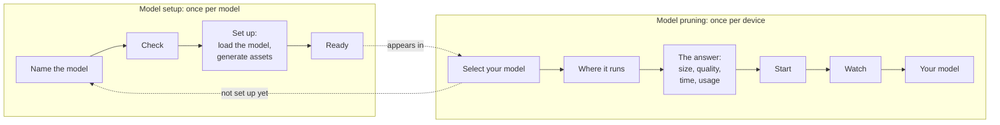
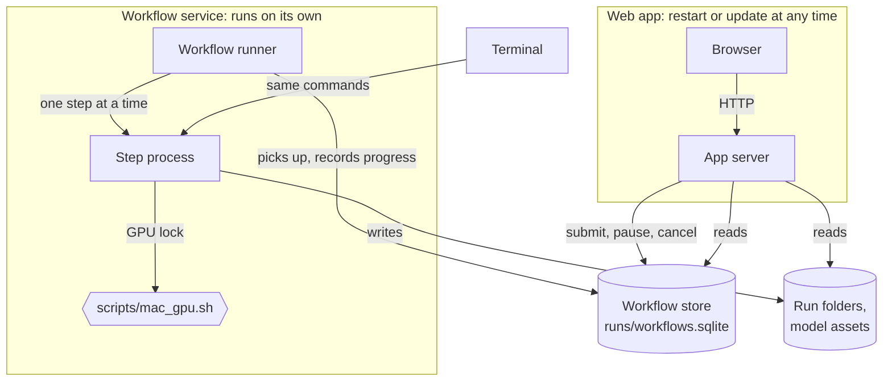

# PruneAgent App Design

- **Status:** draft for Steph's review, 2026-11-19
- **Scope:** the web application (task 3.6 onward): who it serves, its two user stories, its pages, how it runs on the
  computer, and its look and wording.
- **Relation to other documents:** ADR-008 decided *that* there is a web app on top of the tools, and that rule
  stays (the app adds no pruning or measuring logic of its own). This document designs the app itself and replaces
  ADR-008's list of five screens. Once approved, its decisions go into ADR-009 and ARCHITECTURE.md §8b.

---

## 1. Who it's for

| Person | Wants | Knows |
|---|---|---|
| **Someone with a computer and a model** (the main user) | A smaller copy of the model that fits their computer, without losing much quality | Common sense; how big their computer's memory is. Not pruning, not training, not the command line |
| **A researcher** (Steph) | To start, watch and compare runs; to trust the numbers | Everything; also uses the command line |
| **An audience** (instructors, a demo) | To see what the AI did and whether it beat the standard method | Not computer science |

The main user decides the design. Researcher features stay, one level down.

### What the app must do

The app serves two separate user stories (§2):

- **Model setup:** put a model on this computer, ready to prune. Once per model; can take hours.
- **Model pruning:** make a smaller copy of a set-up model that fits a device. Once per device or size.

Across both:

1. **No surprises before starting:** whether it can work, how long it takes and how much of the AI usage limits
   it uses, all before anything starts.
2. **Visible progress:** where a long job is and how long is left.
3. **A result you can trust:** quality against the original and against the standard method (FLAP), and whether it
   now fits.
4. **The model in hand:** a download that runs elsewhere.
5. **Nothing lost:** closing the lid, a usage limit, a crash or an app update never loses work; everything can be
   continued.

### Not in scope

Hosting the app for other people; choosing neurons by hand; training; weight quantization (phase 5); models from a
folder on the computer (later).

---

## 2. Two user stories

Maya has an AI model she likes and a Mac mini with 16 GB of memory. She wants the model to run well on that Mac mini.
She knows nothing about pruning.

### 2.1 Model setup

**"I want this model on my computer, ready to prune."**

| Step | Maya sees | Maya decides | The app does | When something's wrong |
|---|---|---|---|---|
| **1 Name the model** | A box for the model's name on Hugging Face; which kinds work | Which model | — | — |
| **2 Check** | Whether it can be used here, its kind, its size, how long setup takes | Set it up, or choose another | Reads the model's details (not its weights): supported kind, fits this computer | Not supported, too big, needs a license, misspelled: one plain sentence and "Choose another" |
| **3 Set up** | Two parts with progress and time left: **load the model** (download it) and **generate assets** (sample text in the model's own pieces, how much it uses each part, the quality cost of each cut) | Pause, continue | Starts the setup workflow | Stopped or failed: "Continue setup" picks up where it stopped |
| **4 Ready** | The model listed as ready | Prune it now, or later | — | — |

Setup ends at "ready". Pruning is a separate story that can start right away or days later.

### 2.2 Model pruning

**"I want a smaller version of my model that fits my device."**

| Step | Maya sees | Maya decides | The app does | When something's wrong |
|---|---|---|---|---|
| **1 Select your model** | Her set-up models, with their size | Which one | — | The one she wants isn't there: a link to model setup |
| **2 Where it runs** | This computer (read automatically) or a preset device: Mac mini, laptop, phone (presets lock memory, Custom unlocks it); how much to keep free for other apps | Which device | Works out the space the model may take: memory − other apps − working memory | Device too small for this model at any size: says so, suggests a smaller model |
| **3 The answer** | "To fit, it must be 20% smaller. Expect about 1.7–1.9× worse than the original; the standard method would be 13× worse. About 1 h 15 min–1 h 35 min. Uses about 14% of your 5-hour limit." | Go ahead, or change the device | Picks the size from the device (with a buffer) and runs the feasibility check, both on its own. No size to choose, no check button | Can't fit: why, and what would |
| **4 Start** | A confirmation: model, device, size, time, usage; "keep the lid open" | Start or cancel | Queues the run, then the final check | Mac busy with another job: "waits for the Mac to be free" |
| **5 Watch** | Progress at a glance: size against target, quality so far, time left; the round-by-round story below | Pause, continue | Streams each round as it lands | Lid closed, usage limit, crash: "Paused" or "Interrupted" with the reason and Continue |
| **6 Your model** | Fits ✓; quality against the original and FLAP; memory requirement; speed; download | — | Shows the final check; builds the saved model | Target missed: the closest result and the gap |

The expected-quality range in step 3 comes from past runs at that model and size; with none yet, it says so.

### 2.3 What changes from today because of the stories

- **The user never chooses a percentage.** The size follows from the device. Today she picks "How much smaller?" on a
  slider and presses "Feasibility check".
- **The final check runs on its own** after every run. Today's time estimate already counts its 20 minutes, but the
  user has to start it by hand, so a run never reaches "Your model" unless she knows to.
- **Download gives the model,** not only the plan file, which works only with this tool (FR12: safetensors plus plan).
- **Setup and pruning are separate.** Today the model page mixes them ("Make it smaller →" at the end of setup,
  "isn't prepared yet" inside New run).

## 3. Pages and navigation

| Page | Address | Story | Holds | Today |
|---|---|---|---|---|
| **Runs** (home) | `#/` | Pruning | Active runs first, each with a progress bar; then finished runs; one main button: "Prune a model" | Run cards plus the "Your computer" panel |
| **Prune a model** | `#/new` | Pruning, steps 1–4 | Step bar: Select your model → Where it runs → The answer → Start | Split between the home panel and New run |
| **Run** | `#/run/<id>` | Pruning, steps 5–6 | While running: the progress view. When finished: the result and download. Below both: "How it got there", the round-by-round replay | The replay, with results under it |
| **Models** | `#/models` | Setup | The models on this computer (ready, setting up, paused) and "Set up a model", which opens the setup steps | "Select your model", which mixed both stories |
| **Compare** | `#/compare` | — | Every finished run against FLAP across sizes (researchers, demo) | Same |
| **Activity** | `#/activity` | — | Every workflow and its steps, with outcome and system logs | The History list on New run |

**Navigation:** Runs · Prune a model · Models · Compare. Activity sits in the footer: it's for fixing problems.

## 4. How it runs on the computer

### 4.1 Two separate services

Everything that takes longer than a page load (model setup, pruning runs, final checks, building a download) runs in
a **background workflow service**, separate from the **web app**. They share files, not a process, and each is
started, stopped and updated on its own.

| Part | Does | Owns | Started by | Updated |
|---|---|---|---|---|
| **Web app** (app server + browser interface) | Shows things; turns clicks into requests | Nothing that matters: it reads the workflow store and the files | `pruneagent web` | Any time, restart included; nothing running notices |
| **Workflow service** | Runs workflows step by step, one GPU step at a time; records progress; retries and resumes | The workflow store | macOS on login (a launchd agent), so it runs without the app open | Only between workflows (§4.3) |
| **Workflow store** `runs/workflows.sqlite` | Every workflow, its steps, their state and logs | — | — | — |
| **Run folders** `runs/<id>/` | Everything about a run: settings, rounds, kept plans, checkpoint, final check, its own copy of the AI's instructions | — | — | — |
| **Model assets** (scores, quick tests, damage table, sample text) | Whether a model is set up | — | — | — |

The app talks to the service only through the workflow store: it writes a request ("set up this model", "pause
this run") and reads state back. If the app is closed, restarting or being updated, workflows carry on. If the
service is stopped, nothing is lost: on start it picks every workflow up at its last finished step.

### 4.2 Workflows

Each user story's long part is one workflow made of steps. A step is one command, the same one a user would type,
and each step saves its result before the next starts, so a workflow can stop after any step and continue later.

| Workflow | Steps | Uses the GPU |
|---|---|---|
| **Model setup** | Load the model → sample text → part usage (scores, quick tests) → cut tests (damage table) | Yes, except loading |
| **Model pruning** | Run (`pruneagent run`, rounds until the target) → final check (held-out, question sets) → build the download (`pruneagent save`) | Yes, except the download |
| **Feasibility check** | One step: `pruneagent run --dry-run --json-result` | No; answered in about half a minute, so it can also run straight from the app |

**States:** waiting → running → finished; or paused (by the user, a usage limit or sleep), with the reason, and
continued from the step it stopped at; or failed, with the error in one line and the logs.

**One GPU step at a time**, across workflows and the terminal (the GPU lock). Workflows wait in the order they were
started; the app shows what each is waiting for.

### 4.3 Updates never reach a running workflow

| What is updated | How |
|---|---|
| **Web app** (pages, app server) | Build the interface into a new folder and swap it in; restart the app server. Workflows don't notice |
| **Workflow code** (runs, setup, checks, AI instructions) | Each workflow runs from the **release** it started with: a fixed copy of the code, kept under `releases/<commit>/`. An update adds a new release; new workflows use it, running ones finish on theirs. Each run folder records its release |
| **Python packages** | Each release has its own environment, so an update can't change a running workflow's packages |
| **Workflow service itself** | Rarely changes. When it does, it's restarted between steps: it stops taking new steps, waits for the running step to finish, restarts and carries on |

**One command does an update:** `scripts/deploy.sh` builds a new release, swaps in the new interface and restarts
the app server. The workflow service is left alone unless the service itself changed.

### 4.4 Live updates

The run page gets each round as it lands (server-sent events, as today), read from the run folder. Workflow progress
on the Runs, Models and Activity pages refreshes every 3 seconds from the workflow store. That's fast enough for steps
that take minutes.

### 4.5 When things go wrong

| What happens | What the user sees | What they can do |
|---|---|---|
| Lid closed, computer asleep | "Interrupted: the computer went to sleep" | Continue; it picks up at the last kept round |
| Usage limit reached | "Paused: usage limit, resets at 16:41" | Continue after the reset |
| A job fails | "Didn't finish", with the last error in one line; system logs in a fold | Continue, or report the logs |
| Another workflow is using the GPU | "Waiting for the Mac to be free (busy with: …)" | Wait, or cancel |
| App closed, restarted or updated | Nothing changes: workflows carry on in the workflow service | Open the app again |
| A model needs a license or isn't supported | One plain sentence, at step 2 | Choose another model |

### 4.6 Safety

Local and single-user: the server listens on 127.0.0.1 only. The browser never sends a command line, only checked
fields (model name pattern, size between 1% and 60%, run id pattern). Keys and the Codex login stay on the server.

---

## 5. Look and wording

### 5.1 Shared parts

Every page is built from these parts and nothing else, so a dialog or a status looks the same everywhere.

| Part | Used for | Notes |
|---|---|---|
| **Page header** | Title, one back link | No intro sentence unless it says something the page doesn't |
| **Step bar** | Prune a model; Model setup | Numbered; done steps get ✓; the current one is highlighted |
| **Panel** | Any group of controls or facts | One border style, one radius |
| **Fact list** | Label → value pairs (dialogs, settings) | Labels are nouns: "Target size", "Time" |
| **Tiles** | Check results: Size, Time, Usage limits | Big value, small note under it |
| **Status badge** | Waiting, Running, Paused, Interrupted, Finished, Didn't finish, Ready | One color per state, same everywhere, always with a word |
| **Progress bar** | Runs, model setup | Always with words: "57 of 128 cuts tested · about 55 minutes left" |
| **Dialog** | Confirmations | Browser `<dialog>`: Escape and the backdrop close it; the safe button has focus |
| **Fold** | System logs, details | Always has an arrow; the summary says what's inside |
| **Notice** | Information, warning, problem | One line in bold, then the reason |
| **Buttons** | One main (filled) button per view; others outlined | The main button names the next step: "Set up this model", "Start run" |

### 5.2 Wording rules

- Plain, short words; what it means for the user, not how it works ("fits your Mac", not "under the memory limit").
- Labels are nouns: "Feasibility check", "Usage limits", "Current state". Not "Check the size".
- Times are ranges and include the final check; a worst case if a run can use all its rounds.
- Usage limits as the share of the 5-hour and weekly limits this run uses.
- "Memory requirement" for the memory a model needs while answering (memory access cost); layers numbered from 0.
- Quality as "X% worse than the original" or "N× worse".
- "Model setup", "Set up", "Setting up"; never "prepare" on screen.
- No internal names on screen ("damage table", "probe", "qwen3_moe"); they stay in system logs.

### 5.3 Screens of every size

Works from phone width up: a 16px side margin, nothing wider than the screen, long model names wrap. Keyboard
works everywhere; motion stops when the computer asks for less motion; light and dark themes.

---

## 6. What changes from today

| Area | Today | Designed | Task |
|---|---|---|---|
| Two stories | One "Select your model" page mixes setup and pruning; New run says "isn't prepared yet" | Models page for setup (§2.1); Prune a model for pruning (§2.2) | 3.12 (new) |
| Size | A "How much smaller?" slider and a "Feasibility check" button | Size from the device, check runs on its own; the answer in plain words | 3.12 |
| Home | Run cards plus the computer panel | Runs, active first with progress; the computer panel becomes "Where it runs" | 3.12 |
| Setup wording | "Prepare this model", "Preparing … for pruning"; `pruneagent prepare` | "Set up this model"; two parts: load the model, generate assets; `pruneagent setup` | 3.12 |
| Active run | Replay controls only | A progress view at the top (§2.2 step 5) | 3.10 |
| Final check | Started by hand on the run page | Queued on its own when a run meets its target | 3.13 (new) |
| Download | The plan file | The saved model (plus plan) | 3.14 (new) |
| Job history | At the bottom of New run | Activity page: workflows and their steps | 3.12 |
| Long-running work | Started and watched by the web app's server; an app restart loses track, an update can change a running run's instructions | A separate workflow service with releases (§4.1–4.3); the app only submits and reads | 3.11 |
| Look | Each part styled where it was first needed | The shared parts of §5.1 | 3.12 |

Suggested order: **3.11** (the workflow service; updates stop being risky) → **3.12** (two stories, structure) → **3.10**, **3.13**, **3.14**.

---

## 7. Questions for Steph

1. **Final check on its own** after every run (adds about 20 minutes of Mac time per run, already in the time
   shown)? Recommended: yes.
2. **Compare page:** visible to everyone, or only from a link on finished runs?
