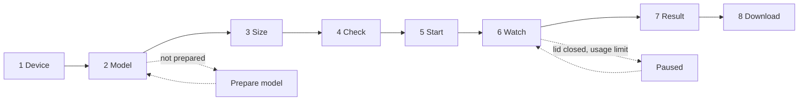
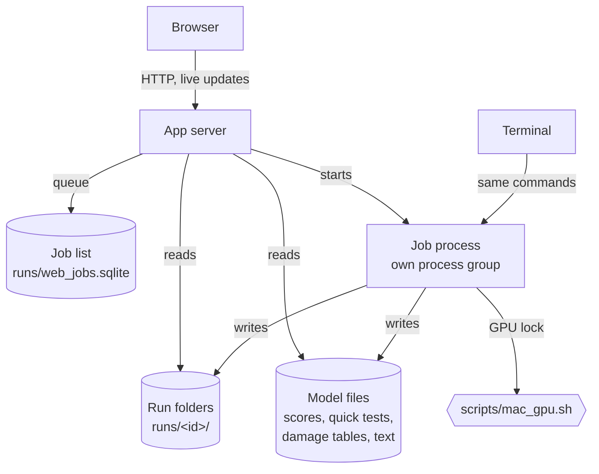

# PruneAgent App Design

- **Status:** draft for Steph's review, 2026-11-19
- **Scope:** the web application (task 3.6 onward): who it serves, the path through it, its pages, how it runs on the
  computer, and its look and wording.
- **Relation to other documents:** ADR-008 decided *that* there is a web app on top of the tools, and that rule
  stays (the app adds no pruning or measuring logic of its own). This document designs the app itself and replaces
  ADR-008's list of five screens. Once approved, its decisions go into ADR-009 and ARCHITECTURE.md §8b.

---

## 1. Who it's for

| Person | Wants | Knows |
|---|---|---|
| **Someone with a computer and a model** (the main user) | A smaller copy of the model that fits their computer, without losing much quality | Common sense; how big their computer's memory is. Not pruning, not training, not the command line |
| **A researcher** (Steph) | To start, watch and compare runs; to trust the numbers | Everything; also uses the command line |
| **An audience** (instructors, a demo) | To see what the AI did and whether it beat the standard method | Not computer science |

The main user decides the design. Researcher features stay, one level down.

### What the app must do

1. **One path** from "this is my computer" to "here is the smaller model", with no step the user has to work out.
2. **No surprises before starting:** whether the size can be reached, how long it takes and how much of the AI usage
   limits it uses, all before anything starts.
3. **Visible progress:** where a run is, how far it is from the target, how long is left.
4. **A result you can trust:** quality against the original and against the standard method (FLAP), and whether it
   now fits.
5. **The model in hand:** a download that runs elsewhere.
6. **Nothing lost:** closing the lid, a usage limit, a crash or an app update never loses work; everything can be
   continued.

### Not in scope

Hosting the app for other people; choosing neurons by hand; training; weight quantization (phase 5); models from a
folder on the computer (later).

---

## 2. The main path

| Step | The user sees | The user decides | The app does | When something's wrong |
|---|---|---|---|---|
| **1 Device** | This computer's memory, read automatically, or a preset device (presets lock memory, Custom unlocks it); how much to keep free for other apps | Which device the model must fit | Works out the model space left (memory − other apps − working memory) | Device too small for any model: says so and stops here |
| **2 Model** | Models on this computer (ready or not), and a box for a Hugging Face name | Which model | Checks a new name: supported kind, fits this computer, preparation time | Not supported, too big, needs a license, misspelled: one plain sentence and "Choose another" |
| **Prepare** (once per model) | A checklist: sample text, part usage, cut tests; progress, time left | Start, pause, continue | Runs `pruneagent prepare` | Stopped or failed: "Continue preparing" picks up where it stopped |
| **3 Size** | Suggested size from step 1 (fits with a buffer), as "X MB → under Y MB, Z% smaller" | Accept or adjust | — | Above 60% smaller: not offered |
| **4 Check** | Reachable or not; time as a range plus the worst case; usage limits as % of the 5-hour and weekly limits | Go on or change the size | Runs the feasibility check (half a minute, no AI call) | Not reachable: the reason and the smallest reachable size |
| **5 Start** | A confirmation dialog: model, size, time, usage; "keep the lid open" | Start or cancel | Queues the run, then the final check | Mac busy with another job: "waits for the Mac to be free" |
| **6 Watch** | Progress at a glance (size against target, quality so far, round, time left); the round-by-round story below | Pause, continue | Streams each round as it lands | Lid closed, usage limit, crash: "Paused" or "Interrupted" with the reason and Continue |
| **7 Result** | Fits ✓; quality against the original and FLAP; memory requirement; speed | — | Shows the final check's numbers | Target missed: the closest result and the gap |
| **8 Download** | The smaller model, ready to use | — | Builds the saved model from the kept plan | — |

Two changes from today follow from this path:

- **The final check runs on its own after every run.** Today's time estimate already counts its 20 minutes, but the
  user has to start it by hand on the run page, so a run never reaches step 7 unless they know to do that.
- **Download gives the model, not only the plan.** The plan file is only useful with this tool; the model file
  (safetensors plus plan, FR12) runs elsewhere.

---

## 3. Pages and navigation

| Page | Address | Holds | Today |
|---|---|---|---|
| **Runs** (home) | `#/` | Active runs first, each with a progress bar; then finished runs; one main button: "Shrink a model" | Run cards plus the "Your computer" panel |
| **Shrink a model** | `#/new` | Steps 1–5 as one guided flow with a step bar (Device → Model → Size → Check → Start) | Spread over the home panel, Select your model and New run |
| **Run** | `#/run/<id>` | While running: the progress view (step 6). When finished: the result (step 7) and download (step 8). Below both: "How it got there", the round-by-round replay | The replay, with results under it |
| **Models** | `#/models` | Models on this computer, prepare or continue preparing, remove; reached from step 2 as well | Select your model |
| **Compare** | `#/compare` | Every finished run against FLAP across sizes (researchers, demo) | Same |
| **Activity** | `#/activity` | Every job (checks, runs, preparations), with outcome and system logs | The History list on New run |

**Navigation:** Runs · Shrink a model · Models · Compare. Activity sits in the footer: it's for fixing problems, not
for the main path.

---

## 4. How it runs on the computer

### 4.1 The pieces, and what each one is the source of truth for

| Piece | Source of truth for | Survives an app restart |
|---|---|---|
| **Run folder** `runs/<id>/` | Everything about a run: settings, each round, kept plans, checkpoint, final check, and (new) its own copy of the AI's instructions | Yes |
| **Model files** (scores, quick tests, damage table, tokenized text) | Whether a model is prepared on this computer | Yes |
| **Model list** `runs/models.json` | Which added models the user sees | Yes |
| **Job list** `runs/web_jobs.sqlite` | What the app was asked to do, each job's log and outcome. *Not* the run's state: that is in the run folder | Yes |
| **Job process** | Doing the work: one process group per job, started with the same command a user would type | Yes (its own process group) |
| **App server** | Nothing of its own: it reads the files above | — (it is what restarts) |
| **GPU lock** | One GPU job at a time, from the app or a terminal | Yes |

The rule that keeps it simple: **the server holds no state that matters.** It can stop and start at any time.

### 4.2 Jobs

| Kind | Command | Uses the GPU | Ends with |
|---|---|---|---|
| Feasibility check | `pruneagent run --dry-run --json-result` | No | A JSON line: reachable, time, usage |
| Run | `pruneagent run` | Yes | The run folder's state: finished, paused, interrupted |
| Continue | `pruneagent resume <id>` | Yes | Same |
| Final check | `scripts/heldout_check.py`, `scripts/accuracy_check.py` | Yes | `heldout.json`, `accuracy.json` |
| Prepare a model | `pruneagent prepare <model>` | Yes | The model files |
| Build the download (new) | `pruneagent save <id>` | No | The saved model |

**States:** waiting → running → finished, paused, failed. A paused job can be continued.

**Follow-up jobs.** A run queues its own final check when it ends with the target met (new). The user doesn't start it.

**After an app restart (new).** Each job's process id is stored. On start, the server looks at every job marked
running: if its process is alive, it keeps watching it; if not, it reads the outcome from what the job left behind
(the run folder's state, the result files). No job is marked "Interrupted" while it is still working.

### 4.3 Updating the app while something runs

Updating the app must never disturb a run in progress. What each kind of update touches, and the rule for it:

| Update | Risk to a running job | Rule |
|---|---|---|
| Interface (pages, styles) | None | Build into a new folder and swap it in at once, so no one sees a half-built page |
| App server code | The server restarts | Jobs are re-attached (§4.2) |
| Run code | None: a running process keeps the code it loaded | — |
| AI instructions | **High today:** a run re-reads them every round, so an update would change what the AI sees mid-run | Each run copies its instructions into its run folder at the start and reads only that copy (new). This also records exactly what the AI saw |
| Check scripts, for a later final check | The check uses the newer code | Accepted: checks measure, they don't decide. Each result file records the code version it ran with |
| Python packages (`uv sync`) | A running job may load a package later and get the new one | Wait until no GPU job runs |

**One command does an update:** `scripts/deploy.sh` merges, builds the interface and swaps it in, restarts the server
if its code changed, and leaves package updates for later if a job is running.

### 4.4 Live updates

The run page gets each round as it lands (server-sent events, as today). The job list and the progress bars on the
Runs page refresh every 3 seconds. That's fast enough for jobs that take minutes per step.

### 4.5 When things go wrong

| What happens | What the user sees | What they can do |
|---|---|---|
| Lid closed, computer asleep | "Interrupted: the computer went to sleep" | Continue; it picks up at the last kept round |
| Usage limit reached | "Paused: usage limit, resets at 16:41" | Continue after the reset |
| A job fails | "Didn't finish", with the last error in one line; system logs in a fold | Continue, or report the logs |
| The Mac is busy with another GPU job | "Waiting for the Mac to be free (busy with: …)" | Wait, or cancel |
| App closed or updated | Nothing changes: runs carry on | Open the app again |
| A model needs a license or isn't supported | One plain sentence, at step 2 | Choose another model |

### 4.6 Safety

Local and single-user: the server listens on 127.0.0.1 only. The browser never sends a command line, only checked
fields (model name pattern, size between 1% and 60%, run id pattern). Keys and the Codex login stay on the server.

---

## 5. Look and wording

### 5.1 Shared parts

Every page is built from these parts and nothing else, so a dialog or a status looks the same everywhere.

| Part | Used for | Notes |
|---|---|---|
| **Page header** | Title, one back link | No intro sentence unless it says something the page doesn't |
| **Step bar** | Shrink a model; Prepare | Numbered; done steps get ✓; the current one is highlighted |
| **Panel** | Any group of controls or facts | One border style, one radius |
| **Fact list** | Label → value pairs (dialogs, settings) | Labels are nouns: "Target size", "Time" |
| **Tiles** | Check results: Size, Time, Usage limits | Big value, small note under it |
| **Status badge** | Waiting, Running, Paused, Interrupted, Finished, Didn't finish, Ready | One color per state, same everywhere, always with a word |
| **Progress bar** | Runs, preparations | Always with words: "57 of 128 cuts tested · about 55 minutes left" |
| **Dialog** | Confirmations | Browser `<dialog>`: Escape and the backdrop close it; the safe button has focus |
| **Fold** | System logs, details | Always has an arrow; the summary says what's inside |
| **Notice** | Information, warning, problem | One line in bold, then the reason |
| **Buttons** | One main (filled) button per view; others outlined | The main button names the next step: "Check →", "Start run" |

### 5.2 Wording rules

- Plain, short words; what it means for the user, not how it works ("fits your Mac", not "under the memory limit").
- Labels are nouns: "Feasibility check", "Usage limits", "Current state". Not "Check the size".
- Times are ranges and include the final check; a worst case if a run can use all its rounds.
- Usage limits as the share of the 5-hour and weekly limits this run uses.
- "Memory requirement" for the memory a model needs while answering (memory access cost); layers numbered from 0.
- Quality as "X% worse than the original" or "N× worse".
- No internal names on screen ("damage table", "probe", "qwen3_moe"); they stay in system logs.

### 5.3 Screens of every size

Works from phone width up: a 16px side margin, nothing wider than the screen, long model names wrap. Keyboard
works everywhere; motion stops when the computer asks for less motion; light and dark themes.

---

## 6. What changes from today

| Area | Today | Designed | Task |
|---|---|---|---|
| Main path | Home panel, Select your model and New run are separate places | One "Shrink a model" flow with a step bar | 3.12 (new) |
| Home | Run cards plus the computer panel | Runs, active first with progress; the computer panel moves into step 1 | 3.12 |
| Active run | Replay controls only | A progress view at the top (§2 step 6) | 3.10 |
| Final check | Started by hand on the run page | Queued on its own when a run meets its target | 3.13 (new) |
| Download | The plan file | The saved model (plus plan) | 3.14 (new) |
| Job history | At the bottom of New run | Activity page | 3.12 |
| App updates | Can change a running run's instructions; restart marks jobs "Interrupted" | §4.3 rules and `scripts/deploy.sh` | 3.11 |
| Look | Each part styled where it was first needed | The shared parts of §5.1 | 3.12 |

Suggested order: **3.11** (updates stop being risky) → **3.12** (structure) → **3.10**, **3.13**, **3.14**.

---

## 7. Questions for Steph

1. **Name of the path.** "Shrink a model" for the guided flow, with "Select your model" as its step 2. Or another name?
2. **Final check on its own** after every run (adds about 20 minutes of Mac time per run, already in the time
   shown)? Recommended: yes.
3. **Compare page:** visible to everyone, or only from a link on finished runs?
