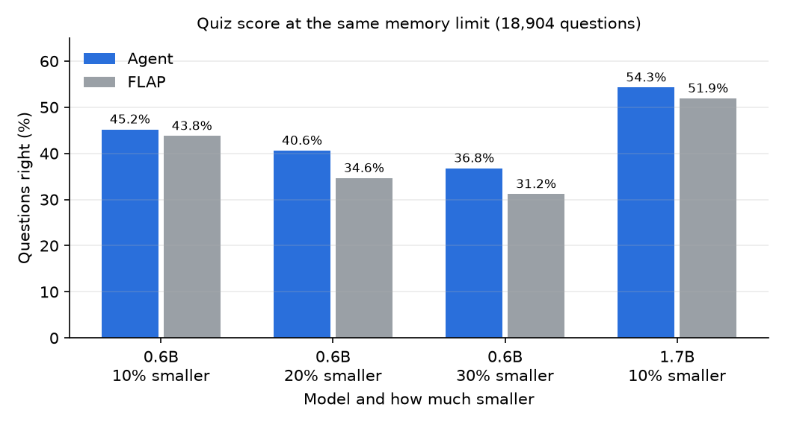

# The agent's smaller models answer more quiz questions right than FLAP's

**Question.** At the same memory limit, does the agent's pruned model answer questions better than FLAP's, and not
just score better on unseen text?

**What we did.** We took the four finished runs (Qwen3-0.6B at 10%, 20% and 30% smaller; Qwen3-1.7B at 10% smaller),
each with FLAP cut to the same memory limit. We gave both models the same 18,904 multiple-choice questions from 7 question
sets, on this Mac, and counted how many each got right. Each set counts by its number of questions.

**What we found.** The agent's model gets more questions right in all four runs. Its lead is small at 10% smaller
(1.4 and 2.4 points) and larger when more is cut (6.0 and 5.6 points).

| Model | Size | Agent | FLAP | Agent's lead |
|---|---|---|---|---|
| Qwen3-0.6B | 10% smaller | **45.2%** | 43.8% | +1.4 |
| Qwen3-0.6B | 20% smaller | **40.6%** | 34.6% | +6.0 |
| Qwen3-0.6B | 30% smaller | **36.8%** | 31.2% | +5.6 |
| Qwen3-1.7B | 10% smaller | **54.3%** | 51.9% | +2.4 |

Per question set (agent / FLAP, % right). The agent wins 22 of the 28 pairs, ties 1 and loses 5, by at most 3 points.

| Question set | Questions | 0.6B, 10% | 0.6B, 20% | 0.6B, 30% | 1.7B, 10% |
|---|---|---|---|---|---|
| Yes/no reading (boolq) | 3,270 | **64.7** / 62.3 | **62.3** / 58.5 | **61.2** / 41.7 | **74.6** / 68.0 |
| Sentence follows? (rte) | 277 | **56.3** / 52.7 | **52.7** / 50.2 | **52.7** / 51.3 | **57.8** / 54.5 |
| Sentence endings (hellaswag) | 10,042 | **36.5** / 36.3 | **32.7** / 27.9 | **29.4** / 27.0 | **46.2** / 44.7 |
| Pronoun puzzles (winogrande) | 1,267 | 56.0 / **57.1** | **53.4** / 50.2 | 52.1 / **52.5** | 64.3 / 64.3 |
| Science, easy (arc_easy) | 2,376 | **61.7** / 55.0 | **49.3** / 31.3 | **38.7** / 29.7 | **69.3** / 67.4 |
| Science, hard (arc_challenge) | 1,172 | **27.6** / 25.4 | **23.0** / 20.5 | 16.8 / **19.7** | **36.0** / 33.2 |
| Open-book science (openbookqa) | 500 | 21.2 / **23.4** | **17.8** / 15.0 | **15.6** / 15.4 | 27.2 / **28.4** |

The two measures agree on the winner every time, but not on the size of the lead. On unseen text (lower is better)
FLAP's 20%-smaller 0.6B model scores 7.5× worse, yet it answers only 6 points fewer questions right:

| Model | Size | Unseen text: agent | Unseen text: FLAP | Unseen text: unpruned |
|---|---|---|---|---|
| Qwen3-0.6B | 10% smaller | 16.46 | 18.46 | 13.30 |
| Qwen3-0.6B | 20% smaller | 23.22 | 175.07 | 13.30 |
| Qwen3-0.6B | 30% smaller | 43.79 | 457.30 | 13.30 |
| Qwen3-1.7B | 10% smaller | 10.98 | 11.43 | 9.89 |

**What we'll do.** Report both measures for every result, quiz score first: it is the one a reader understands. The
final runs (phase 4) add the unpruned models' quiz scores as the no-pruning reference, which these runs don't have yet.
Each run is one try; the tuning repeats ([../tuning/finding.md](../tuning/finding.md)) show run-to-run spread, so the
10%-smaller leads (1.4 and 2.4 points) are the least certain.
