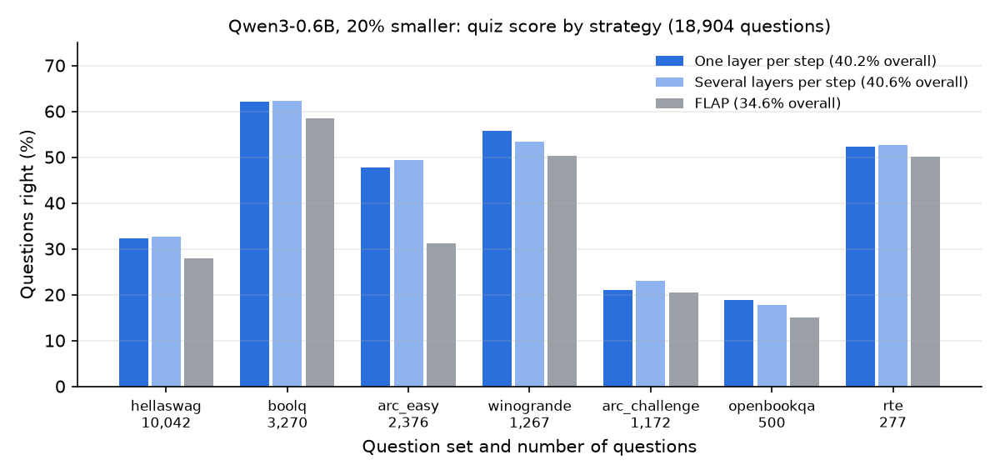

# One layer per step scores the same as several layers per step, at a fixed cost

**Question.** At the same memory limit, does cutting one layer per step (ADR-009) give a better or worse model than
cutting several layers per step, and what does each cost?

**What we did.** Qwen3-0.6B, 20% smaller (limit 953.7 MB), on this Mac. One run with each strategy, the same checks
for both: unseen text, and the same 18,904 multiple-choice questions from 7 question sets (each set counts by its
number of questions). FLAP is cut to the same memory limit.

**What we found.** Both strategies get **40% of the questions right** (one layer per step 40.2%, several layers per
step 40.6%), 6 points ahead of FLAP (34.6%). Each strategy wins some question sets; both beat FLAP on all 7.

| | One layer per step | Several layers per step | FLAP |
|---|---|---|---|
| Quiz, % right | 40.2 | **40.6** | 34.6 |
| Unseen text (lower is better) | 24.9 | **23.2** | 175.1 |
| AI calls | 28 (one per layer, always) | **20** (20 to 39 across runs) | none |
| AI tokens | 290k | **218k** | none |
| Pruning time | **56 min** | 67 min | |

| Question set | Questions | One layer per step | Several layers per step | FLAP |
|---|---|---|---|---|
| Sentence endings (hellaswag) | 10,042 | 32.3 | **32.7** | 27.9 |
| Yes/no reading (boolq) | 3,270 | 62.2 | **62.3** | 58.5 |
| Science, easy (arc_easy) | 2,376 | 47.8 | **49.3** | 31.3 |
| Pronoun puzzles (winogrande) | 1,267 | **55.8** | 53.4 | 50.2 |
| Science, hard (arc_challenge) | 1,172 | 21.0 | **23.0** | 20.5 |
| Open-book science (openbookqa) | 500 | **18.8** | 17.8 | 15.0 |
| Sentence follows? (rte) | 277 | 52.3 | **52.7** | 50.2 |

The cost differs in kind. One layer per step takes one AI call per layer whatever the cut (28 here). Several layers
per step takes fewer calls for a small cut and more for a large one; this run took 20, the tuning runs 20 to 39.

The one-layer run left layer 0, the first layer, as it is, removed layer 13 whole and cut every other layer a little.

**What we'll do.** Keep both strategies. Several layers per step stays the default; the app recommends the one with
fewer AI calls for the chosen model and size (one layer per step when the usual count reaches the number of layers).
Each result is one run. The unseen-text gap (24.9 vs 23.2) is within the spread of repeated several-layers
runs in tuning (22.5 to 24.4, [../tuning/finding.md](../tuning/finding.md)).
