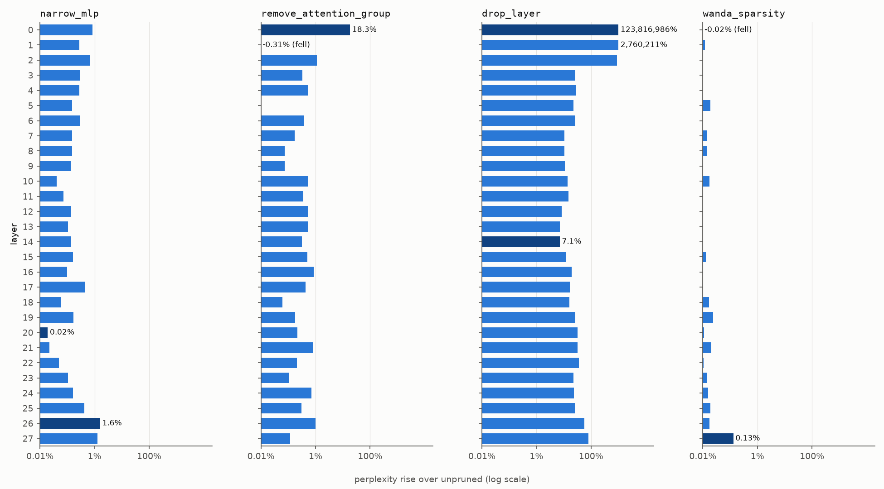

# Measured damage per layer: Qwen3-0.6B-Base

## Headline

Removing a whole layer costs at least 7% in quality (perplexity rises 7%), even in the safest layer, and the quick tests pick the wrong layers for it: of the five layers they rate safest to remove, only one is among the five that really are. The other three kinds of cut cost under 1% in 26 of the 28 layers each. The quick tests do no better than chance at ordering layers for those cuts, but they do tell the four kinds of cut apart correctly.

## The question, and why it matters

The agent shrinks the model one small cut at a time and must decide where each cut goes. It has two sources of advice:

- **Quick tests** (about 30 seconds for all layers): cut one layer and see how much that layer's own output changes.
- **This table** (about 2 hours, measured once before the search): cut one layer, then measure the quality of the whole model.

At the feasibility review we agreed that the quick tests choose *what kind* of cut to make and this table chooses *which layer* gets it. This report gives the table and shows how often it disagrees with the quick tests.

## What we did

We started from the unpruned model each time. We made one cut of one kind in one layer and measured quality on the 32 validation text passages the search uses: 4 kinds of cut × 28 layers = 112 measurements. Quality is perplexity, which measures how surprised the model is by real text (lower is better). The unpruned model scores 13.15. Every number below is the percentage rise over that score.

The four kinds of cut (one step each):

| Label | What one step removes | Memory freed |
|---|---|---|
| `narrow_mlp` | 10% of the layer's feed-forward neurons (320 of 3,072) | 2.0 MB |
| `remove_attention_group` | 1 of the layer's 8 attention groups | 1.6 MB |
| `drop_layer` | the whole layer | 31.5 MB |
| `wanda_sparsity` | sets 10% of the layer's remaining weights to zero | none on its own (the zeros are still stored) |

The unpruned model's weights take 1,192 MB. Since 2026-11-17 the agent's menu has only the first three; `wanda_sparsity` is measured here for completeness.

## Damage per layer

*Each panel is one kind of cut (labels as in the table above). Each bar is one layer, with layer 0 nearest the input. Bar length is the rise in perplexity after one step in that layer alone. All panels share the same log scale, so each gridline is 100 times the one before. Dark bars mark the least and most damaging layer in each panel. A rise smaller than 0.01%, or a fall, shows no bar. Rises above 1,000% are cut off at the edge, with the real value written beside them.*

Chart-ready data: [damage_by_layer.csv](damage_by_layer.csv). Full record with perplexities: [qwen3-0.6b-base__mps__float16.json](qwen3-0.6b-base__mps__float16.json).

| Layer | narrow_mlp | remove_attention_group | drop_layer | wanda_sparsity |
|---:|---:|---:|---:|---:|
| 0 | 0.82% | **18.3%** | **broken** (123,816,986%) | -0.02% |
| 1 | 0.28% | -0.31% | **broken** (2,760,211%) | 0.01% |
| 2 | 0.70% | 1.10% | 888% | -0.01% |
| 3 | 0.29% | 0.34% | 26.0% | -0.01% |
| 4 | 0.28% | 0.53% | 28.5% | 0.00% |
| 5 | 0.15% | -0.18% | 22.8% | 0.02% |
| 6 | 0.29% | 0.37% | 26.9% | -0.02% |
| 7 | 0.15% | 0.17% | 10.6% | 0.02% |
| 8 | 0.15% | 0.08% | 10.6% | 0.01% |
| 9 | 0.13% | 0.08% | 11.1% | 0.00% |
| 10 | 0.04% | 0.52% | 13.6% | 0.02% |
| 11 | 0.07% | 0.35% | 14.7% | 0.01% |
| 12 | 0.14% | 0.52% | 8.5% | 0.00% |
| 13 | 0.11% | 0.55% | 7.2% | 0.00% |
| 14 | 0.14% | 0.31% | **7.1%** | 0.01% |
| 15 | 0.16% | 0.51% | 11.7% | 0.01% |
| 16 | 0.10% | 0.86% | 19.5% | 0.00% |
| 17 | 0.46% | 0.43% | 16.9% | 0.00% |
| 18 | 0.06% | 0.06% | 16.3% | 0.02% |
| 19 | 0.17% | 0.18% | 26.1% | 0.02% |
| 20 | **0.02%** | 0.22% | 31.7% | 0.01% |
| 21 | 0.02% | 0.82% | 32.1% | 0.02% |
| 22 | 0.05% | 0.21% | 35.3% | 0.01% |
| 23 | 0.11% | 0.10% | 23.0% | 0.01% |
| 24 | 0.16% | 0.70% | 23.1% | 0.02% |
| 25 | 0.43% | 0.31% | 25.2% | 0.02% |
| 26 | **1.60%** | 0.99% | 57.6% | 0.02% |
| 27 | 1.30% | 0.12% | 80.9% | **0.13%** |

## What we found

**Safest and most damaging layers.**

| Cut | Safest layers (rise) | Most damaging layers (rise) |
|---|---|---|
| `narrow_mlp` | 20, 21, 10, 22 (0.02–0.05%) | 26, 27 (1.3–1.6%), then 0, 2 (0.7–0.8%) |
| `remove_attention_group` | 1, 5 (quality slightly better), 18, 8 (under 0.1%) | 0 (18%), then 2, 26 (about 1%) |
| `drop_layer` | 14, 13, 12 (7–8.5%), then 7, 8 (about 11%) | 0 and 1 (the model stops working), 2 (888%), 27 (81%), 26 (58%) |
| `wanda_sparsity` | all layers under 0.03% except 27 | 27 (0.13%) |

**Removing a layer frees 15–20 times more memory but costs far more per megabyte.** Removing the safest layer (14) frees 31.5 MB for a 7.1% rise. Narrowing the feed-forward part of the five safest layers frees 10 MB for well under 1% in total, if their effects roughly add up; this table does not test cuts in combination. The first and last few layers should never be removed.

**How well the quick tests agree with this table.** The figure below is rank agreement across the 28 layers: 1 means the same order, 0 means no relation.

| Cut | Agreement | Example of a big disagreement |
|---|---:|---|
| `drop_layer` | 0.65 | Quick tests rate layer 3 the safest to remove, but it ranks 17th (26% rise against 7.1% for layer 14, the real safest). Layers 4 and 6 are similar. |
| `narrow_mlp` | 0.06 | Quick tests rate layer 2 the second safest, but it ranks 25th. Layer 20, the real safest, is near the bottom of their list. |
| `remove_attention_group` | 0.14 | Quick tests rate layer 1 next to worst, but it is the real safest. |
| `wanda_sparsity` | 0.24 | Quick tests rate layer 0 the worst, but it is the real safest. Every layer is under 0.13% here, so the order hardly matters. |
| All 112 cuts together | 0.83 | Quick tests correctly tell the four kinds of cut apart. |

The quick tests do the job we gave them: telling the four kinds of cut apart. They should not be used to pick layers, which is what this table is for. The largest correction is for removing layers: the quick tests would remove layers 3–7, but the real safest are 12–14, then 7–8.

**How firm these numbers are.** Removing a layer gives the same layer order as an earlier, separate measurement on all 128 validation passages (agreement 1.0). For the three small cuts, that agreement is 0.66–0.82, because most layers differ by only a few hundredths of a percent. Trust the outliers (layer 0's attention, layers 26–27's feed-forward part) more than the exact order of the many layers in the middle.

## How it was run

- Model Qwen/Qwen3-0.6B-Base in half precision (float16) on the Mac GPU, run through `scripts/mac_gpu.sh`.
- Pruning used the cached C4 scores (`checkpoints/scores/qwen3-0.6b-base__mps__float16.safetensors`). The model was rebuilt from them for each cut, never recalculated.
- Mac GPU time: 115 minutes, from 22:41 to 00:42 on 2026-11-17/18. The quick tests were recomputed on the Mac with the same C4 scores on 2026-11-18 (`results/probes/qwen3-0.6b-base__mps__float16.json`); agreement figures moved by no more than 0.01.
- Reproduce with `scripts/damage_table.py`, which resumes from its results file, then `scripts/damage_summary.py`.
- The agent loads the table with `SensitivityTable.with_measured_damage`.
