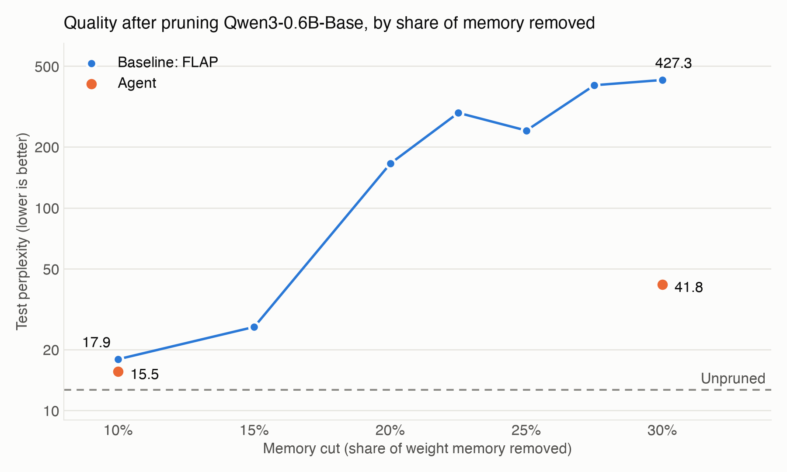

# Midpoint runs: the agent beats Baseline: FLAP at the same memory limit, and FLAP collapses where the agent does not

## Headline

On the small model (Qwen3-0.6B-Base), cut to 10% less weight memory, the agent's model scores **15.55 perplexity on held-out test text, against 17.90 for Baseline: FLAP**: 13% lower (better) at the same memory limit. It got there in 13 rounds, with every round's step kept. Across 18,904 multiple-choice questions it answers **45.2% correctly, against 43.8% for FLAP**: +1.4 points, about 3 times the random variation, so a clear lead. By set, it is clearly ahead on 2 of 7 and behind on none. This is one run on one model.

**Second run, at a 30% memory cut:** FLAP's model breaks down (test perplexity 427), while the agent's degrades but does not collapse (41.8, against 12.7 unpruned). Measuring FLAP at seven cuts shows it falls off a cliff between 15% and 20%. This run also undid 3 steps, which the midpoint checkpoint requires; with it, all four checkpoint conditions are met. See [The 30% run](#the-30-run-a-deeper-cut).

**Third run, at a 20% cut** (just past FLAP's cliff): the agent scores **22.0 test perplexity, against 165 for FLAP**. See [The 20% run](#the-20-run-just-past-flaps-cliff).

## The question

Can the per-layer agent keep more quality than FLAP, the existing method, when both are cut to the same memory limit, with the same calibration data and the same test text?

## What we did

- **Model and limit:** Qwen3-0.6B-Base, weights limited to 1,072.9 MB (10% below the unpruned 1,192.1 MB).
- **Agent:** Codex (gpt-5.6-terra, high reasoning effort) with the v1 instructions. Each round it proposed up to 3 candidates; code applied them, measured perplexity on 32 validation passages, and kept the one with the smallest perplexity rise per MB freed (rejecting any that raised perplexity more than 15% in one round).
- **Evidence given to the agent:** the quick tests and the measured per-layer damage table, both made with the same C4 calibration as FLAP.
- **Baseline: FLAP:** FLAP cut to the same limit with the same C4 calibration.
- **Held-out check:** because the agent chose every step on those 32 passages, we also measured both models on text the search never saw: the 96 other validation passages and the full WikiText-2 test split.

## Results

Perplexity, lower is better.

| Model | Weight memory | 32 passages used by the search | Held-out validation (96 passages) | Test split |
|---|---|---|---|---|
| Unpruned | 1,192.1 MB | 13.15 | 13.30 | 12.66 |
| **Agent** | **1,071.4 MB** | **16.11** | **16.46** | **15.55** |
| Baseline: FLAP | 1,072.4 MB | 18.84 | 18.46 | 17.90 |

The agent's lead holds on held-out text (11% on unseen validation, 13% on test), so it is not an artefact of choosing steps on the scoring passages.

## Accuracy on multiple-choice questions

Perplexity measures how well a model predicts text; accuracy measures whether it picks the right answer to a question. We scored both pruned models on seven standard question sets used in earlier pruning research (percent correct, higher is better), on the Mac GPU.

**Over all 18,904 questions, each counted once: agent 45.2%, Baseline: FLAP 43.8%, a gap of +1.4 points.** The random variation in that gap is about 0.5 points, so the gap is about 3 times it: a clear lead. A plain average of the seven set scores would give a 277-question set the same say as a 10,042-question one, so we do not use it. Hellaswag is 53% of the questions, so it weighs most in this figure.

By set, a gap counts as clear only when it is about twice the random variation expected for a set of that size.

| Question set | What it tests | Questions | Unpruned (Colab GPU) | **Agent** | Baseline: FLAP | Agent minus FLAP | Clear difference? |
|---|---|---:|---:|---:|---:|---:|---|
| arc_easy | school science questions, easier | 2,376 | 65.2 | **61.7** | 55.0 | +6.7 | **yes** |
| boolq | yes/no questions about a passage | 3,270 | 69.9 | **64.7** | 62.3 | +2.4 | **yes** |
| arc_challenge | school science questions, harder | 1,172 | 33.2 | 27.6 | 25.4 | +2.2 | no |
| rte | does one sentence follow from another | 277 | 69.7 | 56.3 | 52.7 | +3.6 | no |
| hellaswag | the most sensible ending for a sentence | 10,042 | 41.0 | 36.5 | 36.3 | +0.2 | no |
| winogrande | who or what a pronoun refers to | 1,267 | 58.5 | 56.0 | 57.1 | −1.2 | no |
| openbookqa | science questions needing a known fact | 500 | 24.6 | 21.2 | 23.4 | −2.2 | no |

The agent is clearly ahead on 2 sets and FLAP is clearly ahead on none; the other 5 are too close to call. The unpruned scores were measured earlier on a Colab GPU, so compare them loosely; the two pruned models were measured the same way on the same machine.

## How the agent got there

| Round | Kept step | Perplexity after (32 passages) |
|---|---|---|
| 1 | Drop layer 14 | 14.09 |
| 2 | Remove an attention group in layer 5 | 14.06 |
| 3 | Remove an attention group in layer 1 | 14.02 |
| 4–11 | Narrow the feed-forward block in layers 5–12 and 21, a few at a time | 14.71 |
| 12 | Drop layer 13 | 15.57 |
| 13 | Narrow 10 more feed-forward blocks and remove an attention group in layer 7, to land just under the limit | 16.11 |

It followed the measured damage table rather than the misleading quick tests: it dropped layers 14 and 13, which the table shows are the safest to drop, not layers 3–7, which the quick tests suggested. Its reasons cite the evidence it used, for example "Measured single-step perplexity is 14.09 (+7.1%) for a 31.5 MB reduction, the best measured whole-layer tradeoff."

## The 30% run: a deeper cut

The 10% run never undid a step, which the midpoint checkpoint requires, so we ran the same setup at a 30% cut (weights limited to 834.5 MB).

**Checkpoint conditions.**

| Condition | Result |
|---|---|
| At least one step kept | Met: 27 |
| At least one step undone | Met: 3 (rounds 5, 27 and 28) |
| Fewer than 60 agent calls | Met: 32 |
| Under 2 hours, run finishes | Met: 93 minutes of running time (paused once, from 11:04 to 11:33, to move the laptop) |

A step is undone when every proposal in a round would raise perplexity by more than 15%. In round 5 the agent proposed dropping a fourth whole layer (+16 to +17%); in rounds 27 and 28 it proposed large bundles of narrowing near the limit (+19% to +28%). Each time the model stayed as it was and the agent switched to smaller steps. Rounds 30 and 31 were also refused because the agent proposed plans already tried; it proposed new ones the next round.

**What the agent built.** It dropped layers 12, 13 and 14, narrowed the feed-forward block in 23 of the remaining 25 layers (most to between a quarter and half of their width), and removed 1 or 2 of the 8 attention groups in layers 1 to 9.

**Perplexity.**

| Model | Weight memory | Held-out validation (96 passages) | Test split |
|---|---|---|---|
| Unpruned | 1,192.1 MB | 13.30 | 12.66 |
| **Agent** | **833.5 MB** | **43.79** | **41.78** |
| Baseline: FLAP | 834.4 MB | 457.30 | 427.32 |

**Where FLAP breaks down.** To check that 427 is a real collapse and not a fault, we pruned FLAP at seven cuts with the same data. The 10% and 30% cuts reproduce the numbers above exactly.

*Test perplexity (log scale, lower is better) against the share of weight memory removed, for Qwen3-0.6B-Base. Blue: Baseline: FLAP at seven cuts. Orange: the agent's three runs. Dashed: the unpruned model. Data: `results/flap_curve/test_ppl_by_cut.csv`.*

| Memory cut | 10% | 15% | 20% | 22.5% | 25% | 27.5% | 30% |
|---|---|---|---|---|---|---|---|
| Baseline: FLAP, test perplexity | 17.9 | 25.9 | 165 | 294 | 241 | 403 | 427 |

FLAP degrades gradually to 15% and then breaks down by 20%. Past that point its scores jump around (25% scores better than 22.5%), as expected once a model has stopped working. FLAP cannot prune the word table (about a quarter of the model's memory), so a 30% cut of total memory means removing about 40% of everything else; the agent reaches the same memory partly by dropping whole layers.

**Accuracy.** Over all 18,904 questions: agent 36.8%, Baseline: FLAP 31.2%, +5.6 points, about 12 times the random variation, so a clear lead. At this cut, though, both models have lost most of their question-answering ability, so the table also shows the score from guessing.

| Question set | Score from guessing | **Agent** | Baseline: FLAP | Agent minus FLAP | Clear difference? |
|---|---|---|---|---|---|
| boolq | 62 (always "yes") | **61.2** | 41.7 | +19.5 | **yes** |
| arc_easy | 25 | **38.7** | 29.7 | +9.0 | **yes** |
| hellaswag | 25 | **29.4** | 27.0 | +2.4 | **yes** |
| rte | 50 | 52.7 | 51.3 | +1.4 | no |
| winogrande | 50 | 52.1 | 52.5 | −0.4 | no |
| openbookqa | 25 | 15.6 | 15.4 | +0.2 | no |
| arc_challenge | 25 | 16.8 | 19.7 | −2.9 | no |

The agent's model is still clearly above guessing on arc_easy and slightly on hellaswag; FLAP's is barely above guessing anywhere. On boolq the agent's 61.2% is about what always answering "yes" scores, while FLAP's 41.7% is worse than that. On the other four sets both are at or below guessing. In short, at 30% the agent's model degrades instead of collapsing; neither model is usable for these questions.

## The 20% run: just past FLAP's cliff

Same setup, weights limited to 953.7 MB (20% below unpruned), to put an agent point where FLAP has already broken down.

| Model | Weight memory | Held-out validation (96 passages) | Test split |
|---|---|---|---|
| Unpruned | 1,192.1 MB | 13.30 | 12.66 |
| **Agent** | **952.3 MB** | **23.22** | **21.99** |
| Baseline: FLAP | 952.2 MB | 175.07 | 165.19 |

20 rounds: 18 steps kept, 2 undone (rounds 15 and 19, where every proposal raised perplexity by more than 15%). It dropped layers 14, 13 and 12 (in rounds 1, 11 and 14), removed attention groups in layers 1, 5, 8 and 9, and narrowed the feed-forward block in most other layers. The last step (round 20) was the costliest: +14.6% to land under the limit. Accuracy was not measured for this run.

13 Codex calls (about 114,000 tokens; about 8 minutes of agent time in total) and about 24 minutes of Mac GPU time for the search, plus about 15 minutes for the held-out check and 74 minutes for the accuracy check. No Colab.

The 30% run: 32 Codex calls (about 397,000 tokens; 16% of the 5-hour allowance and 5% of the weekly), 93 minutes of Mac GPU for the search, plus about 15 minutes for the held-out check, 89 minutes for the accuracy check and 45 minutes for the FLAP curve. No Colab.

The 20% run: 20 Codex calls (about 218,000 tokens; 5-hour allowance at 11% and weekly at 7% afterwards), 67 minutes of Mac GPU for the search, plus about 19 minutes for the held-out check. No Colab.

## Limits

- One run per memory limit, one model. Codex's answers vary from run to run; repeats come in tuning (3.1).
- The accuracy lead is smaller than the perplexity lead: +1.4 points over all questions (clear), and by set clear on 2 of 7, too close to call on the rest.
- The small model only; the production comparison on 1.7B is phase 4.

Files: `decisions.jsonl` (every round, candidates and reasons), `plans/` (every kept plan), `heldout.json` (held-out numbers), `accuracy.json` (accuracy per question set); the 30% and 20% runs' files end in `_30pct` and `_20pct`; the FLAP curve is in `results/flap_curve/`. Reproduce with `scripts/heldout_check.py runs/<run-id>` and `scripts/accuracy_check.py runs/<run-id>`; the curve with `scripts/flap_curve.py` and `scripts/flap_curve_chart.py`.
